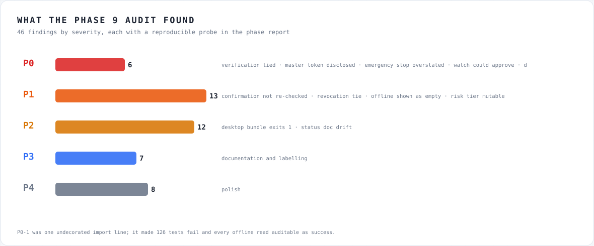

# JARVIS Forge

A permissioned, **local-first** personal agent OS. You type or say a sentence; it is
planned by deterministic rules, gated by a permission engine, held for confirmation
when the risk says so, executed against your real machine, **verified by observing the
world afterwards**, and written to a tamper-evident audit chain. It runs with no API
key, no network and no vendor — an LLM is optional and off by default.

What this repository is mostly about is not features. It is about the difference
between *"the handler returned"* and *"the thing happened"* — and the twenty phases of
measurement spent closing that gap, in the ledger and on the screen.

[](https://github.com/abhijeet1267/jarvis-forge/actions/workflows/ci.yml)
[](tests)
[](jarvis/tools)
[](jarvis/config.py)
[-6b7688)](.github/workflows/ci.yml)

| | |
|---|---|
| **Runtime** | Python 3.11+ · FastAPI · SQLite (32 tables) · stdlib-first |
| **Planning** | `RulePlanner` — 38 deterministic routes, no model required |
| **Authority** | `PermissionEngine` · 5 risk tiers · 25 confirmation-gated tools |
| **Proof** | tri-state `Verification` (success / failed / **unknown**) on every action |
| **Ledger** | `action_logs` hash-chained + `audit.jsonl` append-only, `verify_chain()` |
| **Edge** | token file `0600` · constant-time compare · same-origin · Host allowlist · 600/min |
| **Surface** | web dashboard · voice (macOS `say`/STT) · watch queue · phone pairing |
| **Size** | ~48k lines · 32k source · 16k tests · 45 test modules |

---

## Verified status

Every figure below is produced by a command in the right-hand column. Nothing here is
typed in by hand: the charts in `assets/` are **generated** from `benchmarks/*.json`,
and the diagrams read their counts from the live registry.

| Claim | Value | Reproduce |
|---|---|---|
| Test suite | **1300 passed · 0 failed · 1 skipped · 3 xfailed** (1304 collected) | `python -m pytest -q` |
| Suite growth, Phase 9 → 21 | 875 passing / **126 failing** → 1300 passing / 0 failing at the Phase 21 close | `cat benchmarks/suite_history.json` |
| Tools registered | **127** | `python -c "from jarvis.core.orchestrator import JarvisCore as J; print(len(J().tools.names()))"` |
| Confirmation-gated | **25** of 127 | `python assets/build_diagrams.py` (prints the live counts) |
| Risk tiers | read 68 · low 33 · external 12 · high 11 · physical 3 | same |
| API routes | **104** | `python -c "s=open('jarvis/api/app.py').read(); print(sum(s.count(f'@app.{v}(\"') for v in ('get','post','put','patch','delete')))"` |
| Acceptance commands measured | 17 of 18, live, over HTTP | `python benchmarks/acceptance_run.py` |
| Launched-server sweep | 8 read endpoints **200**, unauthenticated **401**, commands answered over the network | `python run.py serve`, then the sweep in `audit/PHASE21_SPEED_RESILIENCE_REPORT.md` §1 |
| Audit chain integrity | `verify_chain() → ok=True` over **2 recorded actions** (an empty chain verifies trivially, so run two commands first) | `JARVIS_HOME=$(mktemp -d) python -c "import asyncio;from jarvis.core.models import CommandRequest as R;from jarvis.core.orchestrator import JarvisCore as J;c=J();[asyncio.run(c.handle(R(text=t,source='probe'))) for t in ('Jarvis, what time is it.','Jarvis, what is my laptop battery.')];print(c.audit.verify_chain())"` |
| Regenerated figures parse as SVG | 7/7 | `python assets/build_charts.py && python assets/build_diagrams.py` |
| CI on the pushed commit | `suite (3.11)` and `suite (3.12)` both **success** | `gh run list --workflow ci.yml --limit 1` |

> On the author's own machine `~/.jarvis-forge` still reports `verify_chain()`
> `ok=False` with **5 breaks** — residue from the pre-verification records and the
> tamper tests, documented as addenda C-2/C-2a in `audit/PHASE9_FINAL_REPORT.md` and
> `audit/PHASE10_TRUTH_AUTHORITY_REPORT.md`. A fresh `JARVIS_HOME` verifies clean.

**Not verified, and not pretending otherwise:**

| Item | Status | Why |
|---|---|---|
| Physical robot / AMR / arm motion | **HARDWARE UNAVAILABLE** | no bridge reachable; `emergency_stop` says so in its own reply |
| Car telemetry | **NOT CONFIGURED** | no OBD-II adapter or vehicle API; refuses rather than invents a number |
| Watch delivery | **UNPAIRED** | prompts queue locally; a simulated companion *delivers*, never *answers* |
| Phone | **NO DEVICE PAIRED** | refuses the question instead of reporting a battery level |
| Email / calendar accounts | **LOCAL STORES ONLY** | `local_maildir` / `local_calendar`; no credentials configured |
| Voice capture | **ENVIRONMENT-BLOCKED** | macOS denied the microphone to an unbundled process |
| Packaged desktop app | **BROKEN — exits 1** | Phase 9/10 finding, still open; see [Downloads](#downloads) |
| Live browser-driven UI test | **NOT PERFORMED** | browser interaction is blocked by the agent runtime's policy; the page's JS is instead executed from the shipped file by Node |

---

## Contents

- [How a sentence becomes a verified act](#how-a-sentence-becomes-a-verified-act)
- [The state vocabulary](#the-state-vocabulary)
- [Benchmarks](#benchmarks)
- [Hardware truth](#hardware-truth)
- [The twenty phases](#the-twenty-phases)
- [Security model](#security-model)
- [Quickstart](#quickstart)
- [Repository layout](#repository-layout)
- [Downloads](#downloads)
- [Known open items](#known-open-items)
- [License](#license)

---

## How a sentence becomes a verified act


One funnel, not a side door. Every action — typed, spoken, scheduled, or arriving from
a watch — crosses the same `PermissionEngine`. A **scheduled** job re-evaluates on every
run, records the risk ceiling it was created with, and refuses to exceed it: a schedule
cannot be a way to gain authority later. When a verdict is *confirm*, the runner parks a
pending confirmation and stops. It never approves on your behalf.

## The state vocabulary


The rule this project is built on: **`VERIFIED` may only come from
`actions[].verification == "success"`** — never from an HTTP 200, never from `action.ok`
(which means only *the handler answered*), never from reply wording, and never from a
field a client asserts about itself. Each of those four lookalikes has its own test.

When the evidence does not distinguish a state, the answer is `UNKNOWN` — not a guess,
and not a quiet success.

## Benchmarks

### Suite growth, Phase 9 → Phase 20


Phase 9 inherited **126 failing tests**. The cause was a single import line in
`jarvis/tools/base.py` that left `Verification` undefined, so every tool result raised
`NameError` on construction — one undecorated import, 126 red tests, and every offline
read auditable as a success.

### The plan's own acceptance list, measured


| Command | State the user sees | Audit token | ms |
|---|---|---|---|
| show me my laptop battery | VERIFIED | success | 43 |
| plan my day | VERIFIED | success | 6 |
| remember that this is my AMR project | VERIFIED | success | 5 |
| what did I work on yesterday | VERIFIED | success | 8 |
| check my car fuel | **UNAVAILABLE** | failure | 6 |
| turn on study mode | **UNAVAILABLE** | failure | 5 |
| transfer this file to my phone | **NOTHING EXECUTED** | no_action | 5 |
| design this system | **NOT RECOGNISED** | no_action | 6 |
| schedule two hours for project work tomorrow | **NOTHING EXECUTED** | no_action | 6 |
| draft an email to my teammate | **FAILED** | failure | 7 |
| research this idea | VERIFIED (degraded) | success | 1,722 |
| find my latest project report | VERIFIED | success | 683 |

Median command: **6 ms**; the whole list runs in **2.5 s** end to end, against 22.5 s when
it was first measured. The two numbers above that move are `search` (346-683 ms across
runs — it walks real disk, so it tracks whatever the disk is doing) and `research`, which
spends ~1.7 s discovering that arXiv refuses this client (see below) and then answering
from the local corpus instead. Everything else is stable to within a couple of ms.

Note *"what did I work on yesterday"* reading **VERIFIED** with an empty result: since
Phase 20 it answers about the *day asked about* — `Nothing was recorded in memory on
2026-09-26` — and a read that genuinely returned nothing is a successful read. Before
then it answered with today's activity echo, undated, as a remembered fact.

### What the Phase 9 audit found



## Hardware truth


Nothing is attached to the machine these figures were taken on, and the product says so
in every case. **A simulated actuation is labelled simulated and is no longer audited as
a success** (Phase 18): the simulator accepted the command, nothing in the real world
moved, and the ledger now says exactly that. A simulated *car read* is still a successful
read — reading a labelled simulator is a real read — and that distinction is pinned by a
test so it stays a decision rather than an accident.

## The twenty phases

Each closed with a report in [`audit/`](audit), and each report's claims carry the
command that produced them.

| Phase | What was proven or repaired |
|---|---|
| **9 — Audit** | 15-part read-only sweep: baseline, test truth, `STATUS.md` drift (287 claims → 44 false, 52 stale), permission red team, honesty matrix, hardware matrix, 46 findings |
| **10 — Truth & authority** | 6 P0s: verification authority, master-token disclosure, emergency-stop overstatement, watch approval escape, memory-deletion over-claim, chain-verifier semantics |
| **11 — Real world** | first fully green suite; `write_file` with read-back verification |
| **12 — Command path** | typed sentence → `/command` → planner → permission → confirmation → real file → independent verification → audit |
| **13 — Dashboard truth** | pipeline state rendered from server fields; `VERIFIED` bound to verification alone |
| **14 — Workflows** | multi-step plans made reachable; orphaned `running` jobs fixed; per-step state shown |
| **15 — Acceptance** | the plan's 18 commands run live; **six false successes** found and corrected |
| **16 — Accountability** | route-level refusals audited (`no_action`, `clarification`); ledger `request_id` was holding session ids |
| **17 — Coherence** | a non-executing reply stopped claiming `decision=EXECUTE`; audit card colours decisions differently from failures |
| **18 — Simulation** | simulated actuations no longer audited as `success` |
| **19 — Refusals** | dropped clauses named in the reply *and* the ledger; `VERIFIED IN PART` |
| **20 — Dated recall** | "yesterday" became a date range instead of a search phrase; activity echoes labelled as echoes |
| **21 — Speed & resilience** | unbounded filesystem walk bounded (11.3 s → 0.35-0.68 s, worst case capped at 2.5 s and disclosed) and one refused research source no longer fails the command |

## Smooth and fast

Measured, because "feels faster" is not evidence:

| Path | Before | After |
|---|---|---|
| `search_files`, query that matches nothing, rooted at `~` | **6,955 ms** | **346–683 ms** |
| `search_files`, the acceptance command | 11,299 ms | 683 ms (346 ms on a quieter run) |
| All 17 measured acceptance commands | 22,573 ms | **2,522 ms** |
| Any API read (`/tools`, `/tasks`, `/audit`, `/memory`) | 1-2 ms | unchanged |
| `GET /health`, launched server, warm | 1.5-8 ms (first call in a process: 110 ms) | unchanged — nothing expensive runs per request |
| `JarvisCore()` construction | 29 ms | unchanged |

The ranges are real, not hedging: three separate runs of the same command measured
346 ms, 451 ms and 683 ms, because the fallback walk reads actual disk. What the change
removed is the *unbounded* case — the walk now has a 2.5 s ceiling it reports when it
hits, instead of a worst case that was whatever `~/Library` felt like that day.

Two changes, both bounded and both honest about it:

* **The walk had no ceiling.** It stopped early only when it *found* things, so an
  unmatched query walked all of `~/Library` — macOS' largest tree, and nowhere a user
  means. Now it prunes system/cache directories, caps entries and time, and **says so**
  when it stopped early: a partial search reports `truncated` and the number of entries
  it looked at, because "nothing matched" and "I stopped looking" are different claims.
  Pruned names are returned too, so the boundary is inspectable rather than silent.
* **One dead source used to kill the command.** `research` failed outright when arXiv
  refused. It now retries once, falls back to the local corpus, and names the refusal in
  the answer and in `output.source_errors` — while still never inventing a paper. The
  refusal itself is unresolved and documented: arXiv answers curl 200 and every Python
  client 406 from the same machine at the same moment. It is not the User-Agent, not
  HTTP/1.1 vs HTTP/2, and not the plain-HTTP redirect — three diagnoses I made and
  discarded before measuring it properly.

## Security model

- **Token** — generated at `$JARVIS_HOME/api_token`, mode `0600`; compared in constant
  time. The master token is **never** sent to the browser: `/dashboard` carries a
  single-use 256-bit bootstrap that buys only a short-lived, revocable session.
- **Origin & host** — a missing `Origin` is refused like a foreign one; non-loopback
  `Host` is rejected (anti DNS-rebinding).
- **Rate limit** — token bucket, 600/min, burst 120.
- **Confirmations** — `CONF-` + 128-bit entropy, 300 s expiry, and `pre_execute_check()`
  re-runs the refusal gates at approval time, because conditions can change while a
  prompt sits unanswered. One approval buys exactly one action.
- **Deletion** — `forget_memory` reports which ids and surfaces it removed and which it
  could not, instead of a bare "Forgotten".
- **Redaction** — credentials are redacted before anything reaches the audit log,
  application log, or a model prompt.
- **Refusals are decisions** — a command JARVIS declines still writes a hash-chained
  record. `no execution` never meant `no audit event`.

## Quickstart

```bash
python3.11 -m venv .venv && source .venv/bin/activate
pip install -r requirements.txt
cp .env.example .env                      # defaults are safe; everything is blank

python run.py                             # API on 127.0.0.1:8765
open http://127.0.0.1:8765/dashboard      # the page fetches its own session token

# Authenticated API, from a shell:
TOKEN=$(cat ~/.jarvis-forge/api_token)
curl -s -H "X-JARVIS-Token: $TOKEN" -H 'Content-Type: application/json' \
     -d '{"text":"what is my battery"}' http://127.0.0.1:8765/command

# Prove it to yourself:
python -m pytest -q                       # 1300 passed, 0 failed
python benchmarks/acceptance_run.py       # re-measures the README's numbers
python assets/build_charts.py && python assets/build_diagrams.py
```

No LLM key is needed — the rule planner is the default and the guaranteed fallback.
Set `JARVIS_LLM_*` only if you want the optional model path.

## Repository layout

```
jarvis/
  core/        orchestrator, RulePlanner, models, recovery, tasks, briefing
  security/    permission engine, audit chain, redaction, privacy, path guard
  api/         FastAPI app: 104 routes, auth, origin gate, rate limit
  agents/      15 agents — laptop, phone, home, robotics, car, watch, email, …
  tools/       127 tools across 5 risk tiers, each declaring its own spec
  memory/      hybrid retrieval, lifecycle, forgetting
  scheduler/   recurring jobs, runner with per-run re-authorization
  car/ home/ robotics/ watch/ vision/ research/ design/ coding/
  integrations/ IMAP/SMTP and CalDAV providers with local fallbacks
tests/         45 modules · 1304 collected · includes the dashboard's own JS, run by Node
dashboard/     single-file control panel; state rendered from server fields
audit/         22 phase reports + 4 CSV matrices — the evidence behind this README
benchmarks/    acceptance_run.py and the JSON the charts are drawn from
assets/        generated figures + the two generators that draw them
app/           PyInstaller spec and bundle sources (see Downloads — currently broken)
```

## Downloads

**Source only.** There is no packaged application to download, and publishing one would
be a lie: the desktop bundle exits 1 on launch, which is an open Phase 9/10 finding
rather than a packaging step I can wave away.

- [Download the source (`.zip`)](https://github.com/abhijeet1267/jarvis-forge/archive/refs/heads/main.zip)
- [Download the source (`.tar.gz`)](https://github.com/abhijeet1267/jarvis-forge/archive/refs/heads/main.tar.gz)
- Build it yourself with `python build_app.py` — and expect it to fail until that
  blocker is closed. `install_app.sh` installs nothing until then.

## Known open items

Stated plainly, because the point of this repository is that a gap you can name is
better than a gap you have to discover:

- **CI runs on macOS, and that is load-bearing**: the first runner attempt failed 10
  tests because a GitHub macOS runner is a VM with no battery and no ffmpeg. The
  battery-bound tests are now capability-gated; the voice tests install ffmpeg so their
  premise holds instead of being skipped. Investigating that failure also found a real
  bug -- `created_at` is stored in UTC while "yesterday" is the user's local day, so
  dated recall resolved the wrong day for non-UTC users. Fixed, with a regression test.
- **A green test can still be a laptop-shaped test**: the Phase 21 suite passed locally and
  failed on the runner, because `search_files` asks Spotlight first and GitHub's macOS
  image indexes a temp file the instant it is written, while a laptop does not. So an
  assertion about the *walk* was being answered by the *index*. Fixed by pinning the code
  path under test and adding the matching precedence test -- reasoning in
  `audit/PHASE21_SPEED_RESILIENCE_REPORT.md` §8.
- Desktop bundle exits 1 · no `read_file` route · no notification tool ·
  `POST /memory/{id}/forget` still over-claims · no `ProjectGraph` delete API ·
  risk tier is mutable at runtime (RT-3) · recovery retries too broadly (R-2) ·
  R-11–R-14 · hardware integration blocked · external calendar/mail credentials ·
  LLM planner · multi-step **unattended** workflows · a partly-routable sentence can
  still answer one half without flagging the other in some phrasings (14-D, narrowed in
  Phase 19, not fully closed) · a refusal and a clarifying question share one label
  because separating them would mean guessing from punctuation (19-B) · failed
  authentication is logged but deliberately **not** written to the audit chain, so an
  unauthenticated caller cannot append to it (16-F, reasoned in
  `audit/PHASE20_DATED_RECALL_REPORT.md`) · **arXiv still refuses this client** (15-F):
  `curl` gets 200 while urllib and httpx both get 406 from the same machine in the same
  minute, so `research` spends ~1.6 s on a retry, answers from the local corpus, and names
  the refusal instead of inventing a paper. Measured, not assumed — see
  `audit/PHASE21_SPEED_RESILIENCE_REPORT.md` §4 for the three diagnoses that were tested
  and discarded.

## License

**No licence file exists in this repository**, so no permission to copy, modify or
distribute is granted — default copyright applies. This is stated rather than assumed
because the neighbouring repositories in this account carry `LICENSE` files and it would
be easy to paste an MIT badge that nothing backs. Add a `LICENSE` and this section will
tell the truth about it.
