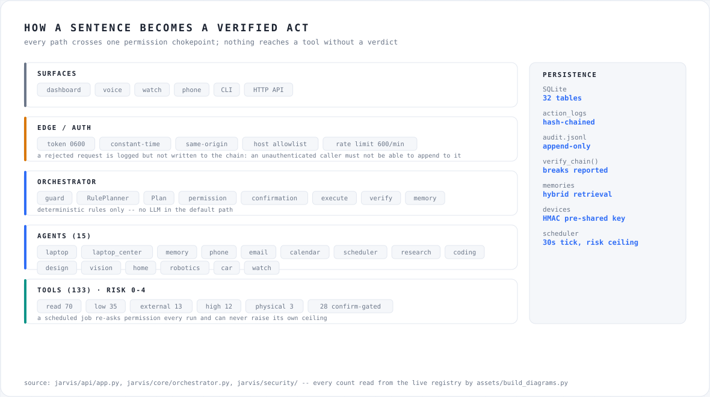
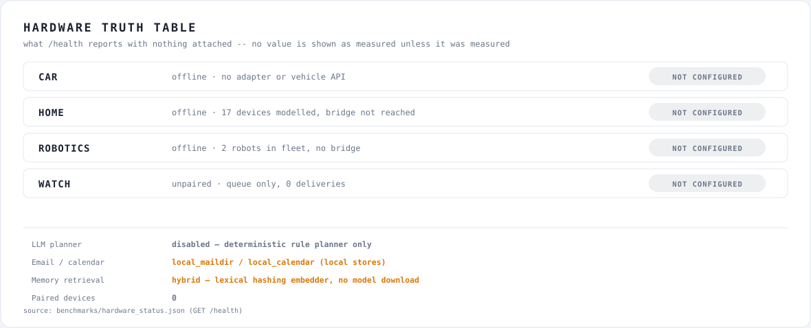

# Vantage

A permissioned, **local-first** personal agent OS. You type or say a sentence; it is
planned by deterministic rules, gated by a permission engine, held for confirmation
when the risk says so, executed against your real machine, **verified by observing the
world afterwards**, and written to a tamper-evident audit chain. It runs with no API
key, no network and no vendor — an LLM is optional and off by default.

What this repository is mostly about is not features. It is about the difference
between *"the handler returned"* and *"the thing happened"* — and the fifty-five phases of
measurement spent closing that gap, in the ledger and on the screen.

> **On the name.** The product is **Vantage** — in the README, both web clients, the install
> manifest, the launcher window, the macOS permission prompts and `Vantage.app`. What did *not*
> change is deliberate: the Python package is still `jarvis`, the 89 environment variables are
> still `JARVIS_*`, the data directory is still `~/.jarvis-forge`, the auth header is still
> `X-JARVIS-Token`, the phone stores its pairing under the `jarvis.device` key, the voice wake
> word is still "Jarvis", and the bundle identifier is still `com.jarvisforge.app` — because
> renaming that last one would drop the microphone and speech grants macOS has already given the
> app, and renaming the data directory or the device key would orphan a working install and
> un-pair every handset. A test pins each of those spellings so a future "finish the rename"
> cannot quietly break them. `audit/*.md`, `STATUS.md` and `BASELINE_REPORT.md` keep the old name
> too: they are dated evidence of what was true then.

[](https://github.com/abhijeet1267/jarvis-forge/actions/workflows/ci.yml)
[](tests)
[](jarvis/tools)
[](jarvis/config.py)
[-6b7688)](.github/workflows/ci.yml)

| | |
|---|---|
| **Runtime** | Python 3.11+ · FastAPI · SQLite (32 tables) · stdlib-first |
| **Planning** | `RulePlanner` — 52 deterministic routes, no model required |
| **Authority** | `PermissionEngine` · 5 risk tiers · 28 confirmation-gated tools |
| **Proof** | tri-state `Verification` (success / failed / **unknown**) on every action |
| **Ledger** | `action_logs` hash-chained + `audit.jsonl` append-only, `verify_chain()` |
| **Edge** | token file `0600` · constant-time compare · same-origin · Host allowlist · 600/min |
| **Surface** | web dashboard · phone client page over the LAN · voice (macOS `say` + on-device STT) · watch queue · device pairing · macOS permission status |
| **Size** | 68.5k lines of versioned Python/HTML/JS/Swift · 41.4k source · 27.0k tests · 82 test modules |

---

## Verified status

Every figure below is produced by a command in the right-hand column. Nothing here is
typed in by hand: the charts in `assets/` are **generated** from `benchmarks/*.json`,
and the diagrams read their counts from the live registry.

| Claim | Value | Reproduce |
|---|---|---|
| Test suite | **2190 passed · 0 failed · 0 xfailed · 0 skipped** (62.5 s; one test is network-gated — it skipped as "arXiv could not be reached: The read operation timed out" during the Phase 50 build and has passed since, so a run reports either 2064 + 1 skipped or 2129 + 0) | `python -m pytest -q -rs` |
| Suite growth, Phase 9 → 55 | 875 passing / **126 failing** → 2190 passing / 0 failing / **0 xfailed** at the Phase 55 close | `cat benchmarks/suite_history.json` |
| Tools registered | **142** | `python -c "from jarvis.core.orchestrator import JarvisCore as J; print(len(J().tools.names()))"` |
| Confirmation-gated | **28** of 142 | `python assets/build_diagrams.py` (prints the live counts) |
| Risk tiers | read 71 · low 35 · external 13 · high 12 · physical 3 | same |
| API routes | **108** | `python -c "s=open('jarvis/api/app.py').read(); print(sum(s.count(f'@app.{v}(\"') for v in ('get','post','put','patch','delete')))"` |
| Acceptance commands measured | 17 of 18, live, over HTTP | `python benchmarks/acceptance_run.py` |
| Plan's safety matrix (§45) | **6 of 6** hold — the sixth held since Phase 31 | `python benchmarks/safety_run.py` |
| Launched-server sweep | 8 read endpoints **200**, unauthenticated **401**, commands answered over the network | `python run.py serve`, then the sweep in `audit/PHASE21_SPEED_RESILIENCE_REPORT.md` §1 |
| Phone reaching the laptop over the LAN | `/phone` served **200** at the laptop's own LAN address, forged `Host:` **400**, unauthenticated **401**, and a real browser run: command → confirmation card → **Deny** → audit row `result=denied`, nothing actuated | `JARVIS_LAN_MODE=1 JARVIS_HOST=0.0.0.0 python run.py` (refuses to start without a token), then the page it prints |
| Packaged desktop app | builds, ad-hoc signs, **launches**, and its server answers `/health`; self-test reports **7/9** (the two failures are macOS permissions, not code) | `python build_app.py && JARVIS_SELFTEST=1 "dist/Vantage.app/Contents/MacOS/JarvisForge"` |
| Audit chain integrity | `verify_chain() → ok=True` over **2 recorded actions** (an empty chain verifies trivially, so run two commands first) | `JARVIS_HOME=$(mktemp -d) python -c "import asyncio;from jarvis.core.models import CommandRequest as R;from jarvis.core.orchestrator import JarvisCore as J;c=J();[asyncio.run(c.handle(R(text=t,source='probe'))) for t in ('Jarvis, what time is it.','Jarvis, what is my laptop battery.')];print(c.audit.verify_chain())"` |
| Regenerated figures parse as SVG | 7/7 | `python assets/build_charts.py && python assets/build_diagrams.py` |
| CI on the pushed commit | **Did not run.** The latest pushed commit's two jobs were each cancelled ~6 s after starting with no runner attached and zero steps executed — GitHub's annotation reads "recent account payments have failed or your spending limit needs to be increased". Re-running once reproduced it exactly. Phase 40 is **not pushed at all**, at the reader's request, so its numbers are local measurements only; the last commit a runner did execute (`40c5c89`, Phase 38) was green on both 3.11 and 3.12 | `gh run list --workflow ci.yml --limit 1` · `gh api repos/…/check-runs/<id>/annotations` |

> On the author's own machine `~/.jarvis-forge` still reports `verify_chain()`
> `ok=False` with **5 breaks** — residue from the pre-verification records and the
> tamper tests, documented as addenda C-2/C-2a in `audit/PHASE9_FINAL_REPORT.md` and
> `audit/PHASE10_TRUTH_AUTHORITY_REPORT.md`. A fresh `JARVIS_HOME` verifies clean.

**Not verified, and not pretending otherwise:**

| Item | Status | Why |
|---|---|---|
| Physical robot / AMR / arm motion | **HARDWARE UNAVAILABLE** | no bridge reachable; `emergency_stop` says so in its own reply |
| Car telemetry | **NOT CONFIGURED** | no OBD-II adapter or vehicle API; refuses rather than invents a number |
| Watch delivery | **UNPAIRED** | prompts queue locally; a simulated companion *delivers*, never *answers* |
| Phone | **NO DEVICE PAIRED** | refuses the question instead of reporting a battery level |
| Email / calendar accounts | **LOCAL STORES ONLY** | `local_maildir` / `local_calendar`; no credentials configured |
| Voice capture | **WORKING — on-device** | Apple's Speech framework transcribed a real clip in 637 ms at 0.94 confidence; the twelve-phase "macOS denied it" was a main-thread deadlock in our own helper plus an x86_64 build on an arm64 Mac (Phase 47) |

| Live browser-driven UI test | **PERFORMED** | Playwright drives both clients at 375 px and 1440 px over loopback and the LAN address: taps, dialogs, console, overflow; the shipped page JS is additionally parsed by `node --check` in the suite |

---

## Contents

- [How a sentence becomes a verified act](#how-a-sentence-becomes-a-verified-act)
- [The state vocabulary](#the-state-vocabulary)
- [Benchmarks](#benchmarks)
- [Hardware truth](#hardware-truth)
- [What the system says when something fails](#what-the-system-says-when-something-fails)
- [The fifty-five phases](#the-fifty-five-phases)
- [The plan's safety matrix, run](#the-plans-safety-matrix-run)
- [Smooth and fast](#smooth-and-fast)
- [Security model](#security-model)
- [Quickstart](#quickstart)
- [Repository layout](#repository-layout)
- [Downloads](#downloads)
- [Known open items](#known-open-items)
- [License](#license)

---

## How a sentence becomes a verified act



One funnel, not a side door. Every action — typed, spoken, scheduled, or arriving from
a watch — crosses the same `PermissionEngine`. A **scheduled** job re-evaluates on every
run, records the risk ceiling it was created with, and refuses to exceed it: a schedule
cannot be a way to gain authority later. When a verdict is *confirm*, the runner parks a
pending confirmation and stops. It never approves on your behalf.

## The state vocabulary


The rule this project is built on: **`VERIFIED` may only come from
`actions[].verification == "success"`** — never from an HTTP 200, never from `action.ok`
(which means only *the handler answered*), never from reply wording, and never from a
field a client asserts about itself. Each of those four lookalikes has its own test.

When the evidence does not distinguish a state, the answer is `UNKNOWN` — not a guess,
and not a quiet success.

## Benchmarks

### Suite growth, Phase 9 → Phase 45


Phase 9 inherited **126 failing tests**. The cause was a single import line in
`jarvis/tools/base.py` that left `Verification` undefined, so every tool result raised
`NameError` on construction — one undecorated import, 126 red tests, and every offline
read auditable as a success.

### The plan's own acceptance list, measured


| Command | State the user sees | Audit token | ms |
|---|---|---|---|
| show me my laptop battery | VERIFIED | success | 18 |
| plan my day | VERIFIED | success | 5 |
| remember that this is my AMR project | VERIFIED | success | 4 |
| what did I work on yesterday | VERIFIED | success | 4 |
| check my car fuel | **UNAVAILABLE** | failure | 5 |
| turn on study mode | **UNAVAILABLE** | failure | 4 |
| transfer this file to my phone | **NOTHING EXECUTED** | no_action | 4 |
| design this system | **NOT RECOGNISED** | no_action | 4 |
| schedule two hours for project work tomorrow | **NEEDS DETAIL** | no_action | 3 |
| draft an email to my teammate | **FAILED** | failure | 5 |
| research this idea | VERIFIED | success | 510 |
| find my latest project report | VERIFIED | success | 907 |

Median command: **4 ms**; the 17 measured commands sum to **1,491 ms** in the Phase 43 run.
That one number moves with the network and with the disk, so the split is the part worth
reading: the 15 commands that touch neither total **74 ms**, `research this idea` was **510 ms**
waiting on arXiv, and `find my latest project report` was **907 ms** walking a real `$HOME`. The
same two rows have measured **41,247 ms** (ending *VERIFIED (degraded)* — it named the refusal
instead of inventing a paper, which is 15-F, and the wait itself was 29-B, since bounded by
`net.http_read` and `SENTENCE_BUDGET`) and **65 ms** (with `$HOME` sandboxed to an empty scratch
tree, so there was nothing to descend). A row of this table belongs to one run on one machine;
re-running the command above overwrites the JSON it is drawn from.

Note *"what did I work on yesterday"* reading **VERIFIED** with an empty result: since
Phase 20 it answers about the *day asked about* — `Nothing was recorded in memory on
2026-09-26` — and a read that genuinely returned nothing is a successful read. Before
then it answered with today's activity echo, undated, as a remembered fact.

### What the Phase 9 audit found


## Hardware truth



Nothing is attached to the machine these figures were taken on, and the product says so
in every case. **A simulated actuation is labelled simulated and is no longer audited as
a success** (Phase 18): the simulator accepted the command, nothing in the real world
moved, and the ledger now says exactly that. A simulated *car read* is still a successful
read — reading a labelled simulator is a real read — and that distinction is pinned by a
test so it stays a decision rather than an accident.

## The fifty-five phases

Each closed with a report in [`audit/`](audit), and each report's claims carry the
command that produced them.

| Phase | What was proven or repaired |
|---|---|
| **9 — Audit** | 15-part read-only sweep: baseline, test truth, `STATUS.md` drift (287 claims → 44 false, 52 stale), permission red team, honesty matrix, hardware matrix, 46 findings |
| **10 — Truth & authority** | 6 P0s: verification authority, master-token disclosure, emergency-stop overstatement, watch approval escape, memory-deletion over-claim, chain-verifier semantics |
| **11 — Real world** | first fully green suite; `write_file` with read-back verification |
| **12 — Command path** | typed sentence → `/command` → planner → permission → confirmation → real file → independent verification → audit |
| **13 — Dashboard truth** | pipeline state rendered from server fields; `VERIFIED` bound to verification alone |
| **14 — Workflows** | multi-step plans made reachable; orphaned `running` jobs fixed; per-step state shown |
| **15 — Acceptance** | the plan's 18 commands run live; **six false successes** found and corrected |
| **16 — Accountability** | route-level refusals audited (`no_action`, `clarification`); ledger `request_id` was holding session ids |
| **17 — Coherence** | a non-executing reply stopped claiming `decision=EXECUTE`; audit card colours decisions differently from failures |
| **18 — Simulation** | simulated actuations no longer audited as `success` |
| **19 — Refusals** | dropped clauses named in the reply *and* the ledger; `VERIFIED IN PART` |
| **20 — Dated recall** | "yesterday" became a date range instead of a search phrase; activity echoes labelled as echoes |
| **21 — Speed & resilience** | unbounded filesystem walk bounded (11.3 s → 0.35-0.86 s, worst case capped at 2.5 s and disclosed) and one refused research source no longer fails the command |
| **22 — Safety matrix** | the plan's §45 phrases run for real: ambiguous device words ask instead of actuating, offline control reports one honest state, a missing payload asks, an embedding outage stops masquerading as an empty index |
| **23 — Deletion completeness** | the three defects parked as `xfail` in Phase 10 were fixed at their sources, so a forget means the same thing on both surfaces, checking a deletion no longer re-writes it, and deleted text leaves the process cache too |
| **24 — Refusal vs detail** | a question stopped being labelled a refusal: `clarification` and `refusal` are now backend fields the page reads, `NEEDS DETAIL` became reachable for real, and a clarification no longer advertises a phantom approval |
| **25 — Desktop truth** | the bundle that "exits 1" was a stale claim: it builds, launches and serves; the self-test now runs *on a broken install* (P0-D3), and the installer stopped promising a permission prompt the app never shows |
| **26 — Recovery trust** | re-running is granted by declaration, not by error text (45 tools → 0); `ToolSpec` is frozen, so the risk tier the gate reads cannot be rewritten under it; a retried job says "nothing ran" instead of `running`; and a failure that cannot be recorded is counted instead of vanishing |
| **27 — A retry that retries** | plan §31's `retry` was a record with no dispatch behind it. A step now stores its own parameters, and `POST /tasks/{id}/retry` re-issues the failed steps through the permission gate -- a gated step mints a fresh approval, a step whose parameters were never stored is refused rather than guessed at |
| **28 — Reading is not writing** | "read the readme" *created a document*; an artifact route now needs an authoring verb, and `read_file` -- registered since v0.1 and unreachable from any sentence -- finally answers one |
| **29 — A route fills its own action** | flowcharts and architecture diagrams had been dead since they were written: the route sent a title to a tool that also needs `steps` / `components`, so the gate answered the user with *"missing required parameter 'steps'"* -- even when the sentence named them. What a sentence states is now used; what it omits is asked for |
| **30 — A capability you have is a capability you can ask for** | 46 of 127 tools answered their own name with "I understood the words but not the goal" -- twice the gap the open item had recorded, because that item had been measured by grepping the planner instead of asking the router. A registry-derived route now reaches a tool whose name words a sentence contains, validates the action with the registry before emitting it, and asks in the tool's own description when an argument is missing; three routes that *advertised* capabilities yield to a sentence naming one; and the delete-capable tool that was tiered LOW-and-unconfirmed for as long as it was unreachable was retiered in the same commit |
| **31 — The device you named is the device that changes** | "turn on the heater" resolved to **Study AC** (the gateway filed heating under cooling) and `control_home_device` was LOW with no confirmation, so the request was approved for execution and only an offline gateway stopped a device changing. The synonym, the resolver and the tier were tightened in one commit, the permission engine grew a device guard beside its path guard, and the plan's §45 matrix has held **6 of 6** since |
| **55 — a search that searches** | §6's last gap was `search Google for FastAPI`, and the tempting fix — routing it at `open_url` with `https://www.google.com` — is a lie that renders perfectly: a browser opens, a page loads, nothing was searched, and the reply reads like a success. The risk tier was **measured, not guessed**: all 13 EXTERNAL tools are confirmation-gated, so in this registry EXTERNAL means *changes something outside*, and a read that changes nothing belongs beside `open_url` at LOW — a search behind a per-query approval is a search nobody uses. Three outcomes are kept distinct, because collapsing the last two is the P1-5 bug this project already fixed for mail and calendar: answered with something, answered with **nothing** (`ok`, count 0, "an empty answer from one source, not a claim that nothing exists"), and **could not be reached** (`FAILED`, "This is the network, not an empty result"). Live against a black-hole address — a real connect attempt, no mock — the outage path returned in **5.01 s**, inside the budget Phase 34 gives a sentence, which is the case that used to cost 20. Live against the network: `the heat death of the universe` returned 2 real Wikipedia/DDG results in 143 ms, and `FastAPI` returned nothing, because the Instant Answer API genuinely has no article for it — and the tool said that instead of inventing a summary. The query is data: it is urlencoded with the other parameters, and the test asserts the parsed contract, because **my first assertion was wrong and the code was right** — I checked that `evil.example` did not appear in the URL, when its appearing *inside the encoded value* is correct behaviour; the defect would be a second parameter or a changed host. Measured after: 2190 passing, 142 tools, 52 routes, 28 gated, and **§6 at 37 of 37**. |
| **54 — the two safety doors that had logic and no handle** | `emergency_stop` was a real PHYSICAL-tier tool reachable only by typing a sentence, so the phone — the device §30 names first for a stop — could not pull it. `PermissionEngine.revoke` wrote an explicit denial that **no product surface ever called**: the permission engine had one door and no handle. `POST /emergency_stop` now calls the *registered tool* through the running core — no second stop implementation — asks for no confirmation, and writes a ledger row; `POST /permissions/{tool}/revoke` refuses an unknown tool (404), refuses `emergency_stop` itself (409, because a door lockable from outside is not a safety door), records the denial and then **re-reads the policy** to say whether the capability is actually blocked. Two decisions carry the phase. **A report is not a result:** the stop used to count a job as stopped when `cancel()` returned an accepted report, so it now re-reads the row and sorts on that — and the test forces the failure by patching a cancel that accepts and rolls the row back, which the old code reported as success. **Restore is not grant:** the obvious `grant(tool)` would write `granted=1`, and Phase 49a's rule is that a standing grant downgrades CONFIRM to EXECUTE — un-revoking would have handed the capability more authority than it had before. So restore deletes the denial rows and the tool returns to its declared policy; proven live, where `delete …` came back as CONFIRM, not EXECUTE. Live: 401 unauthenticated, 404 unknown, 409 on the interlock, CONFIRM → revoked → BLOCK → restored → CONFIRM, and a running job read back as `cancelled` from SQLite independently of the tool. A Phase 53 defect fell out of a Phase 54 test: `self_state.py` counted finished steps with `("success", "done")` while the enum value is **`succeeded`**, so every task report said "0 of N step(s) done" — and Phase 53's own live proof had hand-written the wrong string, which is why suite and live run agreed with the bug. No tool and no route was added: 141 tools, 51 routes, 28 gated, unchanged; the surface grew 107 → 111 paths. The two new buttons were **not clicked** in the browser — the session's classifier blocked both and the refusal was respected — so they are proven wired and rendered, not proven pressed. |
| **53 — Vantage talking about itself** | Four of the six §6 self-state sentences reached nothing; **three reached something worse than nothing.** `are you running` was answered by the application probe for an installed app literally named **"You"**, and `what is the current task`, `what are you doing` and `what is your status` went to the general-knowledge question tool -- a confident answer to the wrong question, which is worse than a refusal because a refusal at least tells the user something is missing. No new state store was built: the five capabilities read `policy.pending()` (which expires stale rows before selecting, so the TTL stays one rule in one place), the objects `/health` is built from, `audit.recent()`, and the task table with its step rollup. `stop_current_task` is LOW and confirmation-free because §30 demands a stop be immediately executable -- PHYSICAL stays reserved for the emergency stop -- and it claims nothing until the job's status is read back after the call. `cancel_schedule` was kept out: a schedule is a thing that runs later, a task is one execution now, and conflating them cancels the wrong object while reporting success. The live run taught one behaviour no test suggested: **a command stopped at the permission gate writes no task row at all**, so "what is the current task" answered "nothing is running" -- true, and useless to someone who had just watched an approval appear; both facts are now said. Also measured rather than assumed: `LifecycleReport` defines `__bool__`, so `emergency_stop`'s truthiness test is correct and not a latent bug. Five of this phase's own test assertions were wrong while the product was right, and two more leaked through the shared session database -- green alone, red in the full run, for the third time. Two count guards failed on purpose: the README's route count, and a total this project froze yesterday -- which is now a drift guard on the published number instead of a wall against growth. Measured after: 2129 passing, 141 tools, 51 routes, gates unchanged at 28, §6 at 36 of 37. |
| **52 — the §6 sentences about the laptop** | All 37 utterances the build prompt lists were measured first: 21 worked, 16 did not, and they split three ways, which is why one fix was never going to be one change. Four applications were simply unknown to a nine-entry registry (`open Firefox`, `Contacts`, `Messages`, `System Settings`). Two sentences had an answer sitting in a tool with no route to it -- `get_time` already replies with the date, `get_machine_snapshot` already returns a `hostname`. Two needed capabilities: five standard folders, through a **name allowlist that never takes a path** (so `open ../../.ssh` is a refusal naming what is allowed, and a refused folder launches nothing -- asserted), and the frontmost application. Then the live drive found three defects the 2,013-test suite had not, all of them about this phase's own work or the ground it stood on: the Finder verification query inherited a 20 s default inside a retry loop of four, so **one sentence could take 80 seconds** for a permission prompt no one is watching (Phase 34's rule, broken while adding a capability); a detached launch never sees `open -a`'s exit code, so an uninstalled Firefox could only be answered with "could not confirm" when the truth is "not installed" -- and the two cases are kept distinct and both tested; and `BUNDLE_ROOTS` did not include `/System/Applications`, so the installed check answered *"Mail is not installed on this laptop"* as a confident success about an app the user was looking at. Cross-checked honestly: Finder answers no AppleScript from **any** caller on this machine, so `open Downloads` stays UNKNOWN rather than borrowing Phase 50's subject story. Three count-guards failed on purpose; two of Phase 49's had frozen the tool total at 134 to prove an alias adds no capability, and a frozen total cannot survive real growth -- they now assert the invariant (specs equal distinct names, `/tools` publishes exactly the registry, no alias as its own row), which is stronger, not weaker. Measured after: 2065 passing, 136 tools, 50 routes, 15 applications, §6 at 32 of 37 (13/13 apps, 4/4 folders, 7/7 status, 2/2 observation). |
| **51 — "open Mail" and "open Calendar" reach the applications** | Two sentences the build prompt's §6 lists were answered by the wrong capability, and the mechanisms turned out to be four, not one. `open Mail` was **declined** with a text listing the mail capabilities it had just refused to use, because the application registry knew nine apps and Mail was not one of them. `open Calendar` opened `https://calendar.google.com` because the word is in the known-sites table and the URL rule runs before the application rule. `open Google Calendar` opened `https://www.google.com`, because the table was iterated in dict order and `google` matched before `google calendar` could -- the brand-qualified name lost the half that identified which Google thing was asked for. `open Mail.app` built **`https://Mail.app`**, breaking the first line of the module that owns that rule: *nothing is guessed into a domain*. A registered application now outranks a site of the same word unless the sentence says web/site/browser or names a brand -- with an **exact** lookup, because a fuzzy one resolves "gmail" inside the Mail app and takes gmail away from its own site. Then the machine caught the fix itself: the first launch check grepped the process table for `/Calendar.app/`, passed its tests, agreed live, and was wrong -- with Calendar closed, `Calendar.app/Contents/PlugIns/CalendarWidgetExtension.appex` is still in the table, so a widget the user never opened was enough to say "Calendar is open". The probe now matches the main executable, and the shipped HTML's "Open a site" button types `open the {site} site`, because after this change a bare answer of "calendar" would have opened an application from a button that promises a web page. Live over HTTP on an isolated instance: Mail, Calendar and `Mail.app` all EXECUTE with `verified=True` at 31-402 ms, and `ps` independently shows both main executables. `open Flurbly.app` fails honestly, and `close Mail` **really failed** -- first-run Mail ignores the quit AppleScript and the tool reported its 20 s timeout. Measured after: 2013 passing, 134 tools still 134, 113 routes. |
| **50 — A permission manager that says who answered** | The second attached prompt set the rule: *never display "Permission Granted" until the operating system actually reports that it is granted*. The repo had no permission status at all, so the first version of this phase looked like a straightforward build -- until the same helper, same binary, same machine was run from two callers and produced **four different answers for four capabilities**: speech recognition GRANTED from the bundle and NOT_DETERMINED from a terminal, screen recording GRANTED and denied, microphone NOT_DETERMINED and DENIED, accessibility denied and GRANTED. macOS attributes a TCC decision to the *responsible process*, so a status read is meaningless unless it names who was asked. The card therefore reports status **and** subject: seven capabilities, each with the OS answer plus the path and bundle of the process the OS answered for. The browser caught three truth defects the suite could not: a bundle test that compared a path *part* for equality instead of a suffix, so the delivered app claimed `inside_bundle: False` while running from inside the bundle; a subject line that printed "read by none", because the helper's own bundle id is nil and the host path is the answer that matters; and the same sentence rendered twice. Nothing prompts and nothing grants -- the endpoint is read-only by design, because a status poll that raises a system dialog would be a consent attack. Measured at the close: 1961 passing (the arXiv test is network-gated -- it skipped during the build and passed on the re-measure), 113 routes / 107 paths, live `/permissions` on the delivered app returning `about_bundled_host: True` with 2 granted / 1 needs-Settings / 1 never-asked / 2 unknown / 1 not-gated. |
| **49a — The spec's names, without losing what the old ones carried** | A new spec asked for `open_application`, `get_battery_status`, `get_machine_snapshot`, `get_running_applications`; the registry had all four capabilities under other names, and the user chose to adopt the spec's names. In this codebase a tool name is state, not a label: `permissions.tool`, `confirmations.tool`, `action_logs.tool`, `task_steps.name` and `scheduled_jobs.name` all store it, and the policy lookup is `WHERE tool = ?` -- so renaming by substitution would have **silently deleted a revocation**, an escalation wearing a refactor. The rename is therefore an alias: spec names canonical, old names permanently resolvable, stored-name lookups widened, and 134 tools still 134 with the risk spread unchanged. `open_folder` was deliberately not aliased to `open_project_folder` -- "open Downloads" and "open this workspace in the editor" are two capabilities that share a word. Two findings fell out of the safety test and neither is about names. A device-less `revoke(tool)` revoked nothing: it writes `device IS NULL` and the lookup required the action's device, so the natural call answered EXECUTE with the reason "low-risk action" -- and Phase 10 had *documented* leaving it that way, because widening a NULL grant would extend an authority granted against no device. The fix is asymmetric: a NULL grant stays inert, a NULL denial binds everywhere, because one direction can only remove authority. Measured honestly, no product surface calls `PolicyStore.revoke` today, so that is a trap closed ahead of its first caller rather than a live fault -- the first draft of the comment claimed a user click that does not exist, and was corrected. And the renamed `get_machine_snapshot` was reachable by **no sentence at all** -- "how is my laptop", "machine status", "laptop condition" all returned nothing -- a tool renamed once already in the session and still unreachable, which is Phase 28's defect class surviving 21 phases. A route now answers the machine-condition phrasings. `/tools` was also hiding the alias mapping, because the route builds its own dict: `aliases: None` over live HTTP, so an audit row saying `open_app` looked unrelated to today's `open_application`. Measured after: 1939 passing, 1 skipped (arXiv, named), /tools still 134 rows with no old name present, and `what is my battery` -> `get_battery_status` / `success`. |
| **48 — A name that stays the same** | Closes 38-B / 39-E / 40-A, the item the delivery README told the user to live with: the wifi address changes when the lease renews, and every phone bookmark dies with it. Measured first -- the machine already had a stable name, `mDNSResponder` was running, and `dns-sd` showed an A record for it **on the wifi interface** (IF 12 → the LAN address, TTL 4500). What refused it was this project's own gate, whose comment explained why: a hostname is the DNS-rebinding vector, so only addresses the machine owns were accepted. The rule was over-broad rather than wrong -- RFC 6762 reserves `.local` and public DNS never answers for it, so nobody can register `evil.local` and point it at a victim's laptop -- and the fix is two conditions instead of one: the name must be in `.local` **and** resolve to an address this machine owns, cached per name for 60 s because the check runs on every request and a resolver call per request is a network-driven slow path. Every refusal that made the old rule right is still refused and now tested. Then the browser found the real bug, after the unit tests were green: the panel printed the mixed-case hostname, Chrome lowered it before sending `Origin`, and `origin not in allowed_origins()` is a string comparison -- so `/auth/session` answered **403**, the bootstrap was spent, and the page sat there 401-ing every four seconds. Fixed on both halves: advertise the name in the form a browser will send, and ignore host case in the comparison. The panel now prefers the name in its QR (it had been encoding the very address that expires) and prints the number underneath, because Android's Chrome does not reliably resolve mDNS and a fix that moves the breakage to the other handset is not a fix. |
| **47 — The microphone was never blocked by Apple** | "macOS denied the microphone" had been repeated since Phase 43, in the README, in the marker file, in the error text and in the advice -- and it had never been tested against the thing it blamed, because the marker in the data home was dated Sep 25, before the desktop bundle existed. Sending a real clip to a properly launched Vantage found two defects of ours wearing a refusal's clothes: the Swift helper **blocked the main thread on a semaphore waiting for callbacks Apple delivers on the main queue**, so every call ran to its deadline and a timeout reads exactly like a denial; and the helper was being built **x86_64 on an arm64 Mac** (4m08s) by inheritance rather than choice, where the native build takes 2.2 s. Proving the second part required building the helper inside its own signed bundle, which still aborted -- so the sentence "run from a bundled host" was retired as unactionable advice, replaced by the variable that actually decides it: whether macOS will attribute the process to an app with a usage string, which is about *how it was launched*. Availability became three-state (`proven` / `refused` / `untested`), because a fresh home was answering `can_listen: true` before anything had ever been tried, and the same response body carried `can_listen: true` next to "transcription timed out". The client gates on `may_try` rather than the proof, since a button that only works once it has already worked can never be pressed for the first time. Measured live on the delivered app: **"What is my battery", 0.94 confidence, 637 ms**, wake word stripped, reply spoken, phone mic enabled. |
| **46 — Buttons, not typing** | Asked for "UI better with buttons", both clients were screenshotted first: the phone had **three controls** and hard-coded colours while the panel had moved every colour into tokens, and 134 capabilities were reachable only by inventing a sentence. The buttons type their sentence and run the same `/command` path as typing does -- permission, confirmation, verification and the audit row stay behind every tap, and a second path would be a second set of gates to keep in sync. Two guards turned out to matter more than the styling. **A button's tool existing is not enough:** the first draft of the Ask button said `ask about {subject}`, which parses to `unknown`, so every shipped sentence is now parsed by the real planner in the suite, and the Ask button became `explain {subject}` after measuring which form survives a person's wording. **And the revoke endpoint had no host check** -- while probing for this phase I ran `POST /devices/laptop_main/revoke` against the running app and it answered 200, leaving the laptop's own record `revoked` with no client able to undo it. The guard sits under the route (`HostDeviceError`, refused before any write, 409 plus a `denied` ledger row) because `remove_phone` calls the same layer and escapes only by accident; `/devices` gained `is_host` so the page never guesses which machine it is standing on. The browser then rejected my own design twice: the server's 530-character ear advice rendered as **101px of text wall** under a disabled mic (now one line plus a disclosure), and opening it pushed **627px of page into a 375px viewport** on one unbreakable file path. Measured after: 1884 passing, 0 console errors on both pages at 375 and 1440, `scrollWidth` 375 = `clientWidth` 375, and a Storage tap on the dashboard answering *31.3 GiB free of 228.3 GiB on /* with `VERIFIED`. |
| **45a — A key the app can be given without damaging it** | Phase 42 ended with "put your key in an environment variable", which works and is also the worst place available: `Settings` reads `.env` from the current working directory, and for the installed app that directory is `Vantage.app/Contents/Resources/app` -- the one file to edit sits **inside the bundle**, and Phase 40 had already proved what a file added after signing does to the seal. So the key moved next to the data: `~/.jarvis-forge/llm.env`, 0600, outside the bundle. The shell still beats it, a typo in the file cannot stop the product booting, and a file readable by the whole machine is complained about out loud while still being honoured -- with a test that the warning never prints the secret. `/health` gained `llm_source`, because "configured" already hid the difference between a real key, a typo and an empty file. Measured end to end with a deliberately fake key: an unrecognised sentence reached Google's endpoint, was refused, and reported itself unavailable rather than inventing an answer. What is missing for Gemini is now only the key. |
| **44 — Answers, greetings, and a question that was not a shell command** | Asked to "make it like ChatGPT — what I say they understand", nine natural sentences were run through the router first. Seven returned the fallback they pasted at me. Two were worse: **`what trains run from mumbai to pune` parsed as a request to execute a program called `from`**, and `how do I run a marathon` as one to run `a`, because `\brun\b` matched anywhere in a sentence. The allowlist gate is the only reason that is a routing bug rather than an incident, and a question must never reach an executor: the route is now imperative and anchored, with the real `run ls -la` still routed and the permission verdict proven unchanged. `hello` and `thanks` are answered like greetings instead of parse failures. And `ask_question` gives it actual answers with no model and no key — a Wikipedia summary, the article named in the sentence, READ tier like the paper research that has been fetching all along. Measured live: *what is a train* answered from the real article; *who is apj kalam* 404'd because the article is titled *A. P. J. Abdul Kalam*, which is a textbook feature that fails on real questions, so a miss now searches first and follows the best title — and if the search finds nothing, the reply names the topic and says there is no answer rather than producing one. |
| **43 — A passthrough is not a microphone** | Asked for voice from the phone, one real recording was sent to the running app before anything was built on top of the speech path. It came back **`ok: true, confidence: 1.0`, with no text**. Nothing on the machine can transcribe — Apple refuses Speech Recognition to a process it has not authorised (a marker had sat in the data home since Sep 25), whisper.cpp is not installed, hosted Whisper has no key — so `get_stt()` had fallen through to `TranscriptSTT`, the class whose entire job is echoing a string a *test* fed it, and that stand-in had agreed to have heard a recording. A mic button built here would have reported silence as success and let anything downstream act on it. So the fix went at the claim rather than the caller: backends now declare whether they are `real`, the passthrough refuses a file it was not fed, the endpoint returns an honest failure that names the three ways to give the machine ears — ordered by cost, with the one that ships audio off the box labelled as that — and `/voice/status` answers `can_listen`, which a client can actually use. The button was **not** built, on purpose: it goes in the moment something can hear. |
| **42 — What a model key actually buys** | Offered an API key, the model path was measured before asking for it: config had `llm_base_url`/`llm_api_key`, the router built a real OpenAI-compatible request with a `Bearer` header and a JSON mode, `/health` reported `llm_enabled: true` — and against a local endpoint that logs every call, three sentences produced **zero chat calls and two embedding calls**. `ModelRouter.complete()` had no caller anywhere: a key bought a badge and an egress path for memory text while no sentence ever asked the model anything. So the model was given a job with hard limits — consulted only when the rules return `not_understood`, never when they answer, its words **appended** to the rule router's own sentence rather than replacing it (a fluent reply would claim the pipeline understood something it did not), and its suggestions reported, never executed: no actions, no approval card for something nobody asked for, `stage: model` in the ledger so the chain never reads as if the rules knew. Measured again after the change: `what is my battery` → 0 chat calls; `wobbleth from glintar` → 1, answered with the model's own words, including when they were useless. |
| **41 — The sentences a person actually says** | Asked for "control on the system, an AI like Iron Man", six sentences were run through the planner **before** anything was written, and four of them were broken in four different ways. `open my project` was **declined with a false excuse** -- a note claiming the build had no design or file agent, in a build that registers both and had opened folders in an editor since the phase before. `check storage` had no tool at all. `open github.com` was the interesting one: a hostname was read as a **filename**, so the system built `<home>/github.com` and offered to read it -- not a missing capability but a wrong one, already reachable and already acting. And `find my resume and open it` was two capabilities that both existed with no route between them. Four new tools later (`open_project_folder`, `check_storage`, `open_url`, `find_and_open`), running them found two more things: an Apple event asking Chrome what it is showing **hangs** rather than failing, so the page query now carries its own 4 s deadline like every other read in this build; and a `find_and_open` that found the file and was refused by LaunchServices reported the system's own complaint instead of a success. A name that is not on the short allow-list is **not** guessed into a domain, because inventing one points a logged-in browser at a stranger. |
| **40 — The application, as files** | Asked for the programs as files rather than a commit, so the artifact was copied, run and *checked*: the copy launched, served `/phone` and answered a command, and failed `codesign --verify` — *"a sealed resource is missing or invalid"* — because the bundle had been sealed with 145 files and then grown 127 more just by being used (the server compiles next to the source it reads). Then the app was quit and **kept listening**: the panel died, `ps` showed its server reparented to launchd with PPID 1, and `curl` still got `200` on the wifi address, with nothing on screen able to stop it. The first fix — `SIGTERM`/`SIGINT` handlers — did not work, and was measured rather than assumed: rebuilt, re-delivered, same orphan. Tk does not die by signal; it calls Tcl's `exit`, which leaves the interpreter from C, so no Python handler and no `atexit` ever runs. The guarantee is now made twice, because the two halves fail differently: the panel's own `exit` is bound to the same cleanup the Quit button uses, and the server is told its parent's pid and notices when it is gone — which is the only half that covers a crash or a SIGKILL. Quit: refused, immediate. `kill -9` on the window: the server is gone within six seconds. |
| **39 — The folder you named, the agent you command, and the page between** | Three complaints, three measurements, and one of them was not the code. *"It opens VS Code but not the folder"*: the planner had thrown the path away, `open_app` took no `path` parameter, and a second rule answered *"open my project in VS Code"* with a project summary — so nothing downstream could have opened anything; and after both were fixed the tool still waited 20 s and returned "timed out" while the editor sat open, because **launching a GUI and capturing its stdout are the same bug in different clothes** — the real bundled CLI keeps the inherited pipe open for as long as the editor lives, so the detached spawn got its own `DEVNULL` and the poll went to VS Code's own record on disk rather than to a claim. *"Not give cmds in claude code"*: no tool existed; `run_coding_agent` now shells to the real CLI with `-p --output-format json --add-dir <workspace>`, is EXTERNAL and confirmation-gated, and the consent line names the prompt and the folder leaf rather than the raw dict; live, it asked Claude Code to write a marker into a workspace and the file was on disk afterwards, with the answer read back from the CLI's own JSON (`$0.14033`, one turn, `Verification.SUCCESS`), and the same sentence from the LAN side held for confirmation instead of running. *"Make its UI better"*: the dashboard had **zero** `:hover`, `:focus`, `@media`, `prefers-color-scheme`, `prefers-reduced-motion` or `aria-` rules — the whole dark theme was one unapplied variable block — and the honest fix was to measure it in a browser at 375 and 1440 in both schemes, which is also where the fix for the grid was found: not by reading my own diff, but by failing twice on it (a duplicated function declaration that only Node could see, and a measurement taken from the app's *staged* copy instead of the file I had just edited). |
| **38 — Connect by scanning** | "The URL is not working." Four measurements and no code was among them: nothing was listening on 8765, no server process existed, the laptop's address was still exactly what had been given, and the firewall was off -- the URL had only ever been alive inside my own test runs, and I had killed them. So the fix is not only to start the app: `/health` now answers with the same `reachable_urls()` list that gates the `Host` check, the panel shows the LAN address rather than deriving its own (two derivations drifted once already), and it draws a scan code when the optional encoder is installed and the plain address when it is not. Getting the tests green taught three things: `tk._default_root` is only set for the first interpreter, so a passing-alone/failing-in-sequence pair was the test reading the wrong window; the fixture I added to "fix" that aborted the suite inside Tcl; and `PhotoImage` binds to the wrong interpreter unless given a `master`, with `refresh()`'s blanket `except` hiding the error as "nothing happened". |
| **37 — Vantage** | The project was renamed, in the places a person reads it. Two patterns did almost all the work, and both required a space between the two words, so no identifier could match by accident; the rest was checked by counting every wiring name before and after and diffing (`493` `JARVIS_*` mentions, `59` token headers, `64` data-directory paths, `244` imports — all identical). The boundary was the interesting part, and it is a claim about consequence, not taste: `com.jarvisforge.app` is the identity macOS granted the microphone and speech permissions to, and `jarvis.device` is the key a handset stores its pairing under, so renaming either would cost the user something real. Two findings came out of doing it: the bundle-drift guard silently turned itself into a *skip* when the `.app` folder name changed under its own path constant — a guard that stops running is worse than one that fails — and a new boundary test failed on first run because it asserted the auth header's literal in the file that *uses* it rather than the one that defines it. |
| **36 — Two applications** | "Make one for mobile and one for laptop so I can connect and work." Measured: the built `.app` copied *no source* — `project_path.txt` held an absolute path to this checkout, so the Phase 10 defect (an app that exits 1 because its directory moved) was still shipping 26 phases later; nothing in the launcher could set LAN mode, so Phase 35's phone work was unreachable from the app anyone would actually double-click; and the phone page had no manifest, icons or worker. Now the bundle stages its own code and prefers it, `host` (the link shown) is separated from `bind_host` (the socket), the panel has an *Allow devices on my wifi* checkbox, and the phone gets `/manifest.webmanifest`, two real rendered PNGs and a shell-only service worker. Then the browser refused the story I was about to tell: with HTTPS on and the certificate warning clicked through, Chrome reports a secure context, loads and polls the page fine, and *still* rejects `serviceWorker.register()` — "an SSL certificate error occurred when fetching the script" — so a self-signed LAN cert encrypts but does not make an installable Android app. Running the built app also found a guard that demanded a token startup had not written yet, refusing the one configuration it exists to protect. |
| **35 — Reach the laptop** | The ask was an app on a phone that commands the laptop. Measured first: the API refused every non-loopback `Host`, bound to `127.0.0.1`, and no client page existed for the pairing protocol that does work — so the door was shut, not the lock broken. LAN mode now opens it *only* for addresses this machine owns (a forged `Host:` is still 400), refuses to boot without a token or with a loopback bind, prints the one URL a phone can actually type, and ships `/phone`: pair, command, and Approve/Deny the confirmation from the handset. `check_agent_status` answers "is qoder working" with what `mdls` and `ps` say — live, it answered *installed (version 0.3.4) and running*. Opening the door exposed three defects that only a browser could see, because they live in the page's own JavaScript -- the first live browser drive this project has performed, against the "LIVE BROWSER DRIVE: NOT PERFORMED" disclosure in `audit/PHASE25_DESKTOP_TRUTH_REPORT.md` §7. |
| **34 — One sentence, one deadline** | 29-B's "no bounded read timeout" was kinder than the code deserved: `urlopen(timeout=20)` bounds *silence*, so a server dribbling a byte every 10 ms was measured still waiting at 60 s with no end, and this phase's first red run had to be killed at five minutes because it did not fail — it hung. All three `urlopen` readers now go through `net.http_read`, whose number is a ceiling on the whole call; arXiv's two attempts share one budget; and `SENTENCE_BUDGET` caps the request, because two bounded 30 s reads in one sentence add up to a 60 s wait and the "30" in the source would have been a lie about what anyone experienced. |
| **33 — A question carries its own answer** | 55 capabilities answered a plain request by asking the user to produce an id the system had issued and could print (`list_workspaces` returns `WS-301adce395d5`). Seven enumerators now declare which identifier they own, the orchestrator offers up to four real candidates inside the question, and 19 of those 55 questions carry them. Found on the way: "close the workspace WS-…" answered with a *description* of the workspace and recorded a success. Also found: a test file whose docstring promised an autouse restore fixture that did not exist, leaving stub handlers installed for the rest of the session — green alone, red in a full run. |
| **32 — One vocabulary, one approval** | the router kept eleven device words where the gateway keeps twenty-six, so nine words the system understood were answered as nonsense; and the confirmation prompt re-derived its own line from the raw parameters while the dashboard rendered the stored preview. The pattern is now built from the gateway's own table (pinned by adding and removing a synonym at test time, both directions), and the approval names the thing: *Will do: set Kitchen light (kitchen.light) to 40%* |

### Four kinds of "I ran nothing"

Phase 19 found that a refusal and a clarifying question shared one label, and left it open
because separating them "would mean guessing from punctuation". Phase 24 closed it without
guessing: the string being classified is the **route's own note**, written by the code that
produced it, and a route whose note is a statement sets `clarification=False` explicitly
instead of relying on shape. Measured over HTTP on a launched server:

| Sentence | `plan.reply_kind` | State the user sees | Ledger `result` |
|---|---|---|---|
| send to Arun | `clarification` | **NEEDS DETAIL** | `no_action` |
| turn on the light | `clarification` | **NEEDS DETAIL** | `no_action` |
| delete everything | `refusal` | **BLOCKED** | `blocked` |
| design this system | `not_understood` | **NOT RECOGNISED** | `no_action` |
| what is my phone battery | `declined` | **NOTHING EXECUTED** | `no_action` |

Two properties hold this honest, both tested: a *statement of what is missing* cannot be
promoted into a question the user could answer, and `needs_confirmation` is no longer set on
a clarification — it used to advertise a pending approval for a command with nothing to
approve, which the page would have offered to confirm.

## What the system says when something fails

Phase 9's recovery audit left four findings that every later phase carried forward without
re-measuring. Measured on this tree, all four were real and two were worse than their
one-line summaries:

| Finding | Measured before | Now |
|---|---|---|
| **R-2** — what grants an automatic retry | the guard asked "is it destructive?" and stopped at risk 3, so **45** tools below it were re-executed on a regex over the error text: `move_file`, `copy_file`, `write_file`, `create_event`, `schedule_task`, `send_to_device`, `control_home_device`, `remember_fact`, `compress_path`, `vibrate_watch`… The string that triggers it most reliably, `command timed out after 30.0s`, is the case where the effect is *unknown* | **0**. A retry needs the read tier or a name in `IDEMPOTENT_TOOLS`; error text only ever *stops* retrying early |
| **RT-3** — who owns a risk tier | `ToolSpec` was mutable and `evaluate()` re-reads the registry's same object: setting `delete_file.risk = READ` moved the gate from `CONFIRM (level 3 (destructive) action requires confirmation)` to `EXECUTE (low-risk action)`, made the same action automatically retryable, and rewrote the planner's own catalogue line to `risk=read confirm=False` | frozen, with tuples where a gate reads membership, so `tags.remove("safety")` is refused too. The verdict is unchanged after the attempt |
| **R-11** — a lifecycle verb's promises | `POST /tasks/{id}/retry` returned a job set to `running`, its failed steps reset to `pending`, their `detail` **erased**, and 0 executions; because the briefing counts `running` jobs, a human was told **"1 job(s) in progress."** | the step keeps `failed` and its error text, the job keeps its real state, every verb answers with a `LifecycleReport` and an `executed` count that means what it says, and the briefing says **"1 job(s) failed."** Phase 27 then gave the verb something true to count: `retry` now re-issues the failed steps, so `executed` is how many actually ran |
| **R-13** — a failure ledger that lies by silence | `record_failure` swallowed every exception at `log.info` (measured: 1 failure, 0 rows, normal reply) while `failure_stats()` / `recent_failures()` raised straight through `/metrics`, `/failures` and the briefing | lost writes are counted and surfaced (`unwritten`, `ledger_error`); `/metrics` degrades with the reason, `/failures` answers 503, and the briefing prints `failure ledger unavailable: …` rather than "No failures recorded." |

Two halves of the same audit were assessed rather than assumed fixed. **R-12** (the
confirmed-action path never touched recovery) is closed at its truth half: that path still
does not retry — one approval buys one attempt — but a gated failure is now *recorded*,
which measured as `failures: 1 → 1` before and `1 → 2` after, live over HTTP:

```
$ curl -X POST -H "$TOKEN" localhost:8899/confirm/CONF-b5cdff66…   # a delete with nothing to delete
  That failed: Nothing to delete at …
$ curl -H "$TOKEN" localhost:8899/failures?limit=1
  delete_file: recovered=0 attempts=0 strategy='none'
    note: … — not retried: it ran under a confirmation, and one approval authorises one attempt
```

**R-14** (a successful fallback silently becoming the planned tool's result) is fixed where
it was false in the record — the ledger row for `search_files` now carries
`answered_by: list_directory` — and named as a remaining wording gap in the memory sentence
under [Known open items](#known-open-items).

### Asking to read something used to make JARVIS write something (Phase 28)

Not a mislabelled state this time -- an unrequested write, decided by a substring. The
design route matched the *noun* (`document\w*|readme|guide`) and never looked at the verb,
so the sentence router authored files for requests to read them. Measured on the live tree,
each line below left a new file on disk:

```
>>> "read the readme"     intent=create_documentation decision=EXECUTE
    reply='Created documentation: read the readme (markdown) — read-the-readme-2340c886.md'
>>> "show me the readme"  intent=create_documentation decision=EXECUTE
>>> "open README.md"      intent=create_documentation decision=EXECUTE
```

The word "read" is inside "readme", and no rule could ask to *read* a file at all:
`read_file` has been registered since v0.1, is risk tier READ, and appears nowhere in the
planner -- one of 29 tools no typed sentence could reach. Two changes, both measured:

| Sentence | Before | After |
|---|---|---|
| `read the readme` | wrote `read-the-readme-<id>.md`, "Created documentation" | `read_file`, reply carries the file's text, workspace unchanged |
| `show me the README.md` / `print README.md` / `what does the file README.md say` | authored an artifact | read it |
| `write documentation for the parser` | authored | **still** authors -- the guard is "which verb leads the sentence", not a blocklist |
| `read the file absent.txt` | would have written a document | `File not found: …`, nothing created |
| `read the file /etc/hosts` | — | passed to the engine's guard, which blocks it: `/private is a protected system location` |
| `read ./sub/notes.txt` | — | anchored in the file workspace, not the process's cwd |

An artifact route now has to be *asked* to author (`_authoring_request` compares the first
verb of each class), reads never reach an OS-protected location, and the reply excerpt is
capped at 1,200 characters with a disclosure, because that reply is also what gets
remembered. Building this also turned up a hole in the router's own reporting: a rule that
raised on every call was logged at `info` and returned as "no rule matched", so a broken
append route was indistinguishable from a sentence JARVIS doesn't understand -- it now logs
the rule's name at `warning`, with a test that pins it.

### Forty-six capabilities existed and could not be asked for (Phase 30)

The open item said 28 tools were unreachable, and the number had been produced by grepping
`planner.py` for each tool's name. Asking the router instead of the source file found
**46**: tools whose own name, typed out, was answered *"I understood the words but not the
goal"* — `read_file`, `get_time`, `open_app`, `close_app`, `copy_file`, `list_events` among
them, all of which have routes that are keyed on some other phrasing. Measured live, before
the fix:

```
>>> "cancel event 12"
    intent=calendar  kind=declined  tools=[]
    reply='I can read your schedule, find free time, and create or cancel events. …'
>>> "get the device capabilities of phone_main"
    reply='I can open and close applications, … Registered tools: {127 names}.'
>>> "list the workspace"
    decision=BLOCK  reply="I cannot do that: missing required parameter 'workspace_id'."
```

The first is a route advertising a capability the router did not have; the second is the
word "capabilities" being a help-rule trigger, so naming one capability earned the whole
catalogue; the third is 29-B alive in the shipped tree, reaching a user through a route that
built its parameters in a variable — the exact blind spot the static sweep had admitted.

A capability that exists is now reachable by naming it: a registry-derived route runs last,
matches a tool only when the sentence contains *all* of its name words (at least two, so one
keyword never plans anything), asks `ToolRegistry.validate_params` before it emits, and when
the argument is missing phrases the question out of the tool's own `description` rather than
its field name — *"I can read one message in full — your sentence does not say which one."*
Three advertising routes yield to a sentence that names a capability; refusing routes do not,
because quietly preferring a keyword over a refusal would be a way of talking past the
permission engine. Registering a tool is now also registering a way to ask for it.

Reaching a tool changes nothing about whether it runs: `"cancel event 12"` and
`"sweep expired memories"` both come back `CONFIRM` with no action executed, and the
second one is why this phase retiered a tool in its own commit — `sweep_expired_memories`
permanently deletes, was tiered `LOW` with no confirmation, and had been so for exactly as
long as it had been unreachable. The two facts were holding each other up.

## The plan's safety matrix, run

Section 45 of the working plan names six phrases this system must refuse, clarify or
confirm on, and six disconnections it must survive honestly. They are now a
reproducible artifact rather than a claim, with the expected outcome written down
before the run:

```bash
python benchmarks/safety_run.py      # HOME is sandboxed to a scratch tree; nothing is paired
```

| Phrase | The plan asks for | What the system does | Holds |
|---|---|---|---|
| delete everything | reject | `BLOCKED` — "I will not do that automatically: blanket delete request" | yes |
| install unknown.exe | reject | `BLOCKED` — untrusted executable | yes |
| unlock door | reject | `BLOCKED` — physical security action | yes |
| run this command as root | reject | `BLOCKED` — privilege escalation | yes |
| send to Arun | clarify | `NEEDS DETAIL` — "Send what to Arun, and by which medium?" | yes |
| turn on heater | reject / clarify / confirm | `BLOCKED` — "There is no home device matching 'heater'. The gateway has: Study desk lamp, Study standing desk, Study AC, …" | yes |

The last row printed `FAIL` for nine phases and was 22-G. It closed in Phase 31, and
what closed it was not the benchmark: the gateway's vocabulary filed `heater` and `hvac`
under the kind `ac`, so "turn on the heater" resolved to **Study AC** — an appliance
nobody named — and `control_home_device` was tiered LOW with no confirmation, which means
the request was approved for execution and only the gateway being offline stopped a device
changing. Three layers were tightened in one commit (the synonym, an actuation resolver
that requires every word the user typed to describe the device, and `requires_confirmation
= True`), and the permission engine grew a device guard beside its path guard so no
approval is ever *requested* against a device it cannot identify. See
`audit/PHASE31_THE_DEVICE_YOU_NAME_REPORT.md`.

Before Phase 22 this matrix looked greener than it was. "turn on the light" — a phrase the
plan does not even list — picked *Kitchen light* out of four tied candidates and executed
against it, and the answer never said a choice had been made. Ambiguous device words now
ask, naming every candidate:

> Which light did you mean -- Living room ceiling light, Kitchen light, Bedroom ceiling
> light, Hallway light? Name the room and I will switch it.

## Smooth and fast

Measured, because "feels faster" is not evidence:

| Path | Before | After |
|---|---|---|
| `search_files`, query that matches nothing, rooted at `~` | **6,955 ms** | **346–1,217 ms** |
| `search_files`, the acceptance command | 11,299 ms | 1,217 ms (346 ms on a quieter run) |
| All 17 measured acceptance commands | 22,573 ms | **1,491 ms** as measured, **74 ms** of it once `research` and the `$HOME` walk are separated out (see the note above) |
| Any API read (`/tools`, `/tasks`, `/audit`, `/memory`) | 1-2 ms | unchanged |
| `GET /health`, launched server, warm | 1.5-8 ms (first call in a process: 110 ms) | unchanged — nothing expensive runs per request |
| `JarvisCore()` construction | 29 ms | unchanged |

The ranges are real, not hedging: seven separate runs of the same command measured
346, 451, 494, 534, 683, 855 and 1,217 ms, because the fallback walk reads actual disk. What the change
removed is the *unbounded* case — the walk now has a 2.5 s ceiling it reports when it
hits, instead of a worst case that was whatever `~/Library` felt like that day.

Two changes, both bounded and both honest about it:

* **The walk had no ceiling.** It stopped early only when it *found* things, so an
  unmatched query walked all of `~/Library` — macOS' largest tree, and nowhere a user
  means. Now it prunes system/cache directories, caps entries and time, and **says so**
  when it stopped early: a partial search reports `truncated` and the number of entries
  it looked at, because "nothing matched" and "I stopped looking" are different claims.
  Pruned names are returned too, so the boundary is inspectable rather than silent.
* **One dead source used to kill the command.** `research` failed outright when arXiv
  refused. It now retries once, falls back to the local corpus, and names the refusal in
  the answer and in `output.source_errors` — while still never inventing a paper. The
  refusal itself is unresolved and documented: arXiv answers curl 200 and every Python
  client 406 from the same machine at the same moment. It is not the User-Agent, not
  HTTP/1.1 vs HTTP/2, and not the plain-HTTP redirect — three diagnoses I made and
  discarded before measuring it properly.

## Security model

- **Token** — generated at `$JARVIS_HOME/api_token`, mode `0600`; compared in constant
  time. The master token is **never** sent to the browser: `/dashboard` carries a
  single-use 256-bit bootstrap that buys only a short-lived, revocable session.
- **Origin & host** — a missing `Origin` is refused like a foreign one; non-loopback
  `Host` is rejected (anti DNS-rebinding).
- **Rate limit** — token bucket, 600/min, burst 120.
- **Confirmations** — `CONF-` + 128-bit entropy, 300 s expiry, and `pre_execute_check()`
  re-runs the refusal gates at approval time, because conditions can change while a
  prompt sits unanswered. One approval buys exactly one action.
- **Deletion** — `forget_memory` reports which ids and surfaces it removed and which it
  could not, instead of a bare "Forgotten". Since Phase 23 `POST /memory/{id}/forget`
  delegates to that same code rather than answering `{'deleted': true}` on its own, and
  a deletion evicts the text from the embedding cache instead of leaving it resident.
- **Redaction** — credentials are redacted before anything reaches the audit log,
  application log, or a model prompt.
- **Refusals are decisions** — a command JARVIS declines still writes a hash-chained
  record. `no execution` never meant `no audit event`.

## Quickstart

```bash
python3.11 -m venv .venv && source .venv/bin/activate
pip install -r requirements.txt
cp .env.example .env                      # defaults are safe; everything is blank

python run.py                             # API on 127.0.0.1:8765
open http://127.0.0.1:8765/dashboard      # the page fetches its own session token

# Let a phone on the same wifi drive this laptop (opt-in; it refuses to start otherwise):
JARVIS_LAN_MODE=true JARVIS_HOST=0.0.0.0 python run.py
#   -> prints e.g. "Phone client -> http://192.168.1.40:8765/phone"; open that on the phone.
#   The desktop app needs neither variable: tick "Allow devices on my wifi to connect"
#   in its window and it writes the switch and rebinds.
# Encrypt the link (the session credential then stops crossing the wifi in cleartext):
JARVIS_HTTPS_ENABLED=true JARVIS_LAN_MODE=true JARVIS_HOST=0.0.0.0 python run.py
#   -> the phone URL becomes https://… and the handset shows a certificate warning first.
#      Chrome will still not *install* the client against this self-signed certificate;
#      see 36-A under Known open items for what was measured.

# Authenticated API, from a shell:
TOKEN=$(cat ~/.jarvis-forge/api_token)
curl -s -H "X-JARVIS-Token: $TOKEN" -H 'Content-Type: application/json' \
     -d '{"text":"what is my battery"}' http://127.0.0.1:8765/command

# Prove it to yourself:
python -m pytest -q                       # 2190 passed, 0 failed (2189 + 1 skip when arXiv refuses; the research test is network-gated)
python benchmarks/acceptance_run.py       # re-measures the README's numbers
python assets/build_charts.py && python assets/build_diagrams.py
```

No LLM key is needed — the rule planner is the default and the guaranteed fallback.
Set `JARVIS_LLM_*` only if you want the optional model path.

## Repository layout

```
jarvis/
  core/        orchestrator, RulePlanner, models, recovery, tasks, briefing
  security/    permission engine, audit chain, redaction, privacy, path guard
  api/         FastAPI app: 117 routes (111 distinct paths), auth, origin gate, LAN gate, rate limit
  agents/      15 agents — laptop, phone, home, robotics, car, watch, email, …
  tools/       142 tools across 5 risk tiers, each declaring its own spec
  memory/      hybrid retrieval, lifecycle, forgetting
  scheduler/   recurring jobs, runner with per-run re-authorization
  car/ home/ robotics/ watch/ vision/ research/ design/ coding/
  integrations/ IMAP/SMTP and CalDAV providers with local fallbacks
tests/         82 modules · 2190 collected · includes the shipped page JS, run by Node
dashboard/     index.html control panel + phone.html, the client a phone uses over the LAN
audit/         57 phase reports + 4 CSV matrices — the evidence behind this README
benchmarks/    acceptance_run.py and the JSON the charts are drawn from
assets/        generated figures + the two generators that draw them
app/           PyInstaller spec and bundle sources (the launcher and its wifi switch; see the Phase 36 report)
```

## Downloads

**Source only** — and the reason changed in Phase 25. The bundle is no longer broken
(it builds, ad-hoc signs, launches, and its server answers), so "it doesn't work" is no
longer the argument. What still stops a published binary is different and holds: an
ad-hoc signature is enough for *this* Mac, not for a build handed to strangers — that
needs an Apple Developer identity, notarization, and a TCC-stable bundle id, which is a
distribution decision rather than a packaging step I can quietly take.

- [Download the source (`.zip`)](https://github.com/abhijeet1267/jarvis-forge/archive/refs/heads/main.zip)
- [Download the source (`.tar.gz`)](https://github.com/abhijeet1267/jarvis-forge/archive/refs/heads/main.tar.gz)
- Build it yourself: `python build_app.py` (into `./dist`), or `./install_app.sh` to move
  it into `/Applications` — it keeps any previous install as `Vantage.app.previous`
  rather than deleting it. Then `JARVIS_SELFTEST=1` on the built binary prints what the
  app can actually reach, including the microphone and speech-recognition state.

## Known open items

Stated plainly, because the point of this repository is that a gap you can name is
better than a gap you have to discover:

- **CI runs on macOS, and that is load-bearing**: the first runner attempt failed 10
  tests because a GitHub macOS runner is a VM with no battery and no ffmpeg. The
  battery-bound tests are now capability-gated; the voice tests install ffmpeg so their
  premise holds instead of being skipped. Investigating that failure also found a real
  bug -- `created_at` is stored in UTC while "yesterday" is the user's local day, so
  dated recall resolved the wrong day for non-UTC users. Fixed, with a regression test.
- **A green test can still be a laptop-shaped test**: the Phase 21 suite passed locally and
  failed on the runner, because `search_files` asks Spotlight first and GitHub's macOS
  image indexes a temp file the instant it is written, while a laptop does not. So an
  assertion about the *walk* was being answered by the *index*. Fixed by pinning the code
  path under test and adding the matching precedence test -- reasoning in
  `audit/PHASE21_SPEED_RESILIENCE_REPORT.md` §8.
- **An unnamed robot still gets a default at the planner** (`jarvis/core/planner.py:1884`,
  `self._robot_ref(text) or "amr_main"`). The tool no longer infers one for itself — with
  two machines able to `home` or `stop`, `command_robot_motion(robot="")` now asks — but a
  *typed sentence* still lands on a chosen machine, with a confirmation prompt that names
  it. Turning that into a question is deliberately left open: for `stop`, a round trip is
  the wrong trade against a machine that is moving, and that is a judgement about safety
  semantics rather than about truthfulness (23-E).
- **The plan's safety matrix holds 6 of 6** (22-G, closed by Phase 31). `turn on heater`
  used to reach the single HVAC unit in the inventory and be *executed* without
  confirmation, because the gateway's vocabulary filed `heater` and `hvac` under the kind
  `ac` and `control_home_device` was LOW for every device kind. What closed it was a tier
  and a vocabulary decision, not a benchmark edit: `requires_confirmation=True`, the
  heating/cooling conflation removed, an actuation resolver that requires every word the
  user typed to describe the device, and a guard in the permission engine so an
  unidentifiable target is refused rather than put up for approval.
  **31-A** and **31-B** were the residue, and Phase 32 closed both. 31-A: the planner recognised
eleven device words of its own while the gateway kept a 26-word synonym table, so nine words
the system could act on — `power`, `outlet`, `bulb`, `ceiling`, `air`, `conditioner`, `cam`,
`motion`, `energy` — were answered *"I understood the words but not the goal"*. The router now
builds that pattern from the gateway's own vocabulary, which a test pins in both directions by
adding and removing a synonym at run time. 31-B: the confirmation prompt re-derived its own
line from the raw parameters while the dashboard rendered the stored preview — two renderings
of one consent question, and neither naming the device. One string feeds both now: *"Will do:
set Kitchen light (kitchen.light) to 40%"*.
- **A search that searches** (Phase 55 — closes Gap D and §6). Reasoned in `audit/PHASE55_A_SEARCH_THAT_SEARCHES.md`. One keyless provider, three honest outcomes, query confined to its parameter. What it left open: **55-A** the source is encyclopaedic, so a query with no article returns nothing and says so — a ranked web index would answer differently. **55-B** no key-based provider is wired, so there is no ranked path at all; that is a provider decision. **55-C** results are reply text, not rendered links on the phone or panel. **55-D** at the 5 s boundary a slow service is indistinguishable from a dead one. **55-E** `search files for my report` yields the query `"files for my"` — a pre-existing capture bug in another capability's rule, found while writing this phase's boundary test and left for its own phase.
- **The two safety doors** (Phase 54 — closes Gaps B and C). Reasoned in `audit/PHASE54_THE_TWO_SAFETY_DOORS_REPORT.md`. A stop reachable from a client, and a revocation a user can actually perform. What it left open: **54-A** the stop reaches queued JARVIS work only; the menu-bar and lock-screen surfaces §30 names do not exist until the native shell. **54-B** a tool already mid-step is not killed, only the remaining steps are prevented from dispatching. **54-C** revocation has no expiry and no bulk form. **54-D** the panel offers Revoke on all 140 non-interlock capabilities, including ones whose revocation would break the card that shows it — deliberately not special-cased. **54-E** no browser click-through for either control. **54-F** Phase 53's step-status vocabulary bug was found here rather than there, because a hand-written status string hid it in the live proof.
- **Vantage talking about itself** (Phase 53 -- closes Gap A). Reasoned in `audit/PHASE53_VANTAGE_TALKS_ABOUT_ITSELF_REPORT.md`. Approvals, status, recent actions, the current task and a verified stop, all from state the process already owned. What it left open: **53-A** there is no in-process record of the command executing right now, so the task answer comes from the table rather than the moment. **53-B** `/health` and `get_vantage_status` are two projections of one state; agreement is tested, a single builder is not. **53-C** the activity answer reports the ledger and does not verify the chain -- this machine still carries the 5 deliberate forged rows, so the panel reads BROKEN. **53-D** the phone UI polls `/confirmations` directly rather than through the new tool. **53-E** `search Google for X` is still §6's only gap and still needs a capability, not an alias -- a test asserts a search is not answered by opening a home page. **53-F** Gaps B, C, E, F, G, H, I and J of the operating prompt are untouched: no emergency-stop route, no tool-revoke surface, no first-run request path, no host persistence, no native app, no relay, no provider adapters, no Computer Use.
- **The §6 sentences about the laptop** (Phase 52). Reasoned in `audit/PHASE52_SECTION_SIX_ON_THE_LAPTOP_REPORT.md`. Eleven of the sixteen gaps are closed and two capabilities added. What it left open: **52-A** Finder answers no AppleScript from any caller here, so a folder opening cannot be confirmed at all. **52-B** the frontmost-app answer needs Accessibility, which the delivered app does not have -- from the bundle it names the permission instead of the application. **52-C** five named folders and nothing else; "open my screenshots" is not a route. **52-D** the application list is static -- `bundle_installed` can now admit the list is out of date, but nothing reconciles it at startup. **52-E** `System Settings` will not resolve on macOS 12 or earlier, where the bundle is named System Preferences. **52-F** five sentences remain in two kinds of work: four are Vantage talking about itself (pending confirmations, its status, its recent actions, stopping the current task -- routes to state the process already holds) and one, `search Google for X`, needs a capability the registry does not have.
- **The two routes that answered the wrong question** (Phase 51 -- narrows 49a-D). Reasoned in `audit/PHASE51_TWO_ROUTES_ANSWERED_WRONG_REPORT.md`. Mail and Calendar open the applications; the web is reached by saying so. What it left open: **51-A** an unknown `.app` name falls through to `read_file` and reports "File not found: <home>/Flurbly.app" instead of "I know no application called Flurbly". **51-B** app-vs-site precedence reads the static registry, not installed facts (deliberate -- parsing must not touch disk), so on a machine without Calendar.app the sentence fails rather than falling back to the page. **51-C** `close_app` has no answer for an app that will not respond, and does not verify that anything quit. **51-D** the launch probe is macOS-path-shaped; on Windows every launch is *unverified*. **51-E** `open the calendar site` can only mean the Google page. **51-F** the other twelve §6 gaps -- folders, Contacts, System Settings, `is Safari open?`, `search Google for X` -- are untouched.
- **A permission manager that says who answered** (Phase 50). Reasoned in `audit/PHASE50_A_PERMISSION_CARD_THAT_SAYS_WHO_ANSWERED_REPORT.md`. Seven capabilities and their subject are read from the OS and shown on the laptop panel. What it left open: **50-A** `inside_bundle` is an inference from where the server's own code lives, not the responsible-process answer macOS refuses to expose publicly. **50-B** a `GRANTED` row is the OS's state, not proof the feature works -- screen recording has never been exercised from this build. **50-C** nothing can be *granted* from here; the first-run wizard needs a user-initiated request path that is not a side effect of a poll. **50-D** `answered_by.pid` is the helper's transient pid, not the server's. **50-E** notifications read UNKNOWN because the UserNotifications query needs the app's own run loop. **50-F** the helper compiles on first call.
- **The spec's names** (Phase 49a). Reasoned in `audit/PHASE49A_THE_SPECS_NAMES_REPORT.md`. The spec's tool names are canonical and the 48-phase names are permanent aliases. What it left open: **49a-A** the widening depends on the registry knowing the tool -- a policy row for a capability that was *removed* rather than renamed matches only its own spelling, and nothing detects a stored name that resolves nowhere. **49a-B** `confirmations.tool` and `action_logs.tool` were not widened; an in-place upgrade with an approval still queued would cross that line. **49a-C** no product surface can revoke a tool at all -- the permission engine has one door and no handle. **49a-D** the spec's own §6.1 Basic command set is 14 utterances short, and two of those are not gaps but wrong routes: `open Mail` is *declined* and `open Calendar` opens the Google Calendar *website*. **49a-E** `system_status` and `get_machine_snapshot` overlap; the spec names one. **49a-F** `/api/v1/*` is not built -- deliberately, because a second entry point is the thing the spec's own §5 forbids.
- **A name that stays the same** (Phase 48 — closes 38-B, 39-E, 40-A). Reasoned in
  `audit/PHASE48_A_NAME_THAT_STAYS_THE_SAME_REPORT.md`. The laptop is now reachable at
  `http://abhijeets-macbook-air-2.local:8765/phone`, which survives a lease renewal, and the
  panel prints the wifi number underneath for handsets that cannot resolve mDNS. What it left
  open: **48-A** cross-device resolution is inferred from the published A record (`dns-sd` shows
  it on the wifi interface), not observed from a second device -- one tap on the user's phone
  closes that. **48-B** Android's Chrome may not resolve `.local` at all, so on those handsets
  the changing address remains; the real fixes are a DHCP reservation, router-side mDNS, or the
  self-signed https path. **48-C** when the name does not resolve the panel quietly falls back to
  the address and never says why it vanished. **48-D** the 60 s name cache means a renewal is
  visible up to a minute late, and no test has driven a real renewal. **48-E** the 403 that made
  the feature useless was found by hand in a browser after the unit tests were green; nothing in
  the suite would catch the next variant of "the page loads and every call fails" without a real
  browser in the loop. **48-F** a name cannot manufacture a lease: observed the same hour, with
  no IPv4 on the interface the gate still accepts the name (it resolves to loopback, which the
  machine owns) and the panel still advertises it, on a network where the number is equally
  unreachable -- so nothing today distinguishes "a phone can use this" from "this is genuinely
  my address".
- **The microphone was never blocked by Apple** (Phase 47 — closes 43-A, 43-B, 43-D, 42-A,
  46-A). Reasoned in `audit/PHASE47_THE_MICROPHONE_WAS_NEVER_BLOCKED_REPORT.md`. Voice input
  works on this machine now: on-device, no key, 637 ms, 0.94 confidence, wake word stripped,
  reply spoken, and the phone's mic button live. What it left open:
  **47-A** the app exited cleanly during the first experiment and the cause is not established
  -- uvicorn's own `Shutting down` line says a deliberate stop, not a crash, and no crash
  report exists; it happened while a 90 s request and a `swiftc` build were in flight, so an
  unattributed coincidence is the honest description until it repeats. **47-B** `proven` is a
  cache written only by success, so revoking the permission in System Settings leaves the state
  stale in exactly the direction that matters, and deleting the data home resets a working
  machine to `untested`. **47-C** a cold home still pays a helper build inside the first
  request (17.5 s, down from 4m08s); shipping the compiled binary or building it at launch
  removes it. **47-D** a spoken risky command takes two round trips (transcribe → command →
  confirmation card → approve), which is correct for safety and slower than speaking. **47-E**
  `whisper_cpp` and `openai_whisper` remain `untested`, so the three-state machine has been
  earned by one backend only. **47-F** the plan's literal acceptance sentence -- *"Vantage,
  open VS Code."* -- was not fired; the loop was proven with a read-only utterance because the
  real one opens an editor on the user's screen.
- **Buttons, not typing** (Phase 46). Reasoned in `audit/PHASE46_BUTTONS_NOT_TYPING_REPORT.md`.
  What it left open:
  **46-A** `can_listen` reports what backends exist, not whether a spoken word will become text
  here -- measured the same day, a fresh home says `true` for `macos_speech` and the delivered app
  says `false`, because the first real attempt is what writes the block marker, so a first tap can
  enable a button that then fails (it self-corrects on the next status read). **46-B** one accent
  per surface: the phone's primary action is green, the panel's is blue, both are now named tokens
  and neither was changed -- that is a design call with a reviewer missing. **46-C** eight device
  rows in `~/.jarvis-forge` are mine from live test drives; the Forget button can clear them in
  eight taps and did not, because they are the user's data and the ask was a UI. **46-D** the
  ledger labels a host-targeted revoke `remove_phone`, the tool that does that job, so the row
  names a phone while the target is the laptop. **46-E** the mic still has no working backend on
  this machine (43-A unchanged): the control is built, gated and explained. **46-F** `tags` were
  never added to `/tools` -- 134 annotations to power a filter the registry's own names and
  descriptions already serve would have been a taxonomy invented after the fact.
- **A key the app can be given without damaging it** (Phase 45a). Reasoned in
  `audit/PHASE45_A_KEY_OUTSIDE_THE_BUNDLE_REPORT.md`. What it left open:
  **45-A** the phone's microphone button, still waiting on ears (43-A) -- and this key file is
  the thing that could give it some, via hosted Whisper on the same endpoint. **45-B**
  `llm_source` says *where*, not *whether*; a real reachability probe is still 42-B and needs a
  design that does not turn `/health` into a bill. **45-C** the file is plain `KEY=value`: one
  layer of quotes stripped, no `${VAR}` expansion. **45-D** it is read once, in the cached
  `get_settings()`, so a key added while the app runs takes effect on the next launch -- the
  right default for a credential, and a choice that should stay documented rather than
  discovered.
- **Answers, greetings, and a question that was not a shell command** (Phase 44). Reasoned in
  `audit/PHASE44_ANSWERS_NOT_COMMAND_LISTS_REPORT.md`. What it left open:
  **44-A** an answer is the encyclopedia's own opening paragraph, not a synthesis — a long or
  comparative question gets one side of it. **44-B** English only: a question in another language
  is searched in English. **44-C** *what is the capital of France* resolves to the article
  *"Capital of France"*, which is not an answer; that needs a reasoning model or a data source,
  recorded rather than patched with more regex. **44-D** every title miss costs a second network
  read. And the honest frame for all of it: 47 anchored rule shapes is still a phrase list, so
  "what I say they understand" ends at the model, which ends at a key (Phase 42).
- **A passthrough is not a microphone** (Phase 43). Reasoned in
  `audit/PHASE43_A_PASSTHROUGH_IS_NOT_A_MIC_REPORT.md`. What it left open:
  **43-A** the phone's microphone button, deliberately unbuilt until `can_listen` is true —
  grant Speech Recognition to Vantage and clear the marker (free, local, private), or install
  whisper.cpp, or set a hosted key that ships the audio off the machine. **43-B**
  `MacOSSpeechSTT.available()` means *"swiftc exists and we have not been refused in this home
  yet"*, while the contract says *"can transcribe on this machine"* — so a fresh home picks a
  backend that fails on the first clip; the right shape is untested / refused / proven, and it
  cannot be probed at boot because the refusal is a SIGABRT. **43-C** `available.transcript` is
  still reported in the same list as real backends; only `can_listen` tells the truth.
  **43-D** the clip used was a dummy payload Apple rejected before decoding it, so no fixture
  yet proves a *successful* transcription end to end.
- **What a model key buys, and what it does not** (Phase 42). Reasoned in
  `audit/PHASE42_WHAT_A_MODEL_KEY_BUYS_REPORT.md`. What it left open:
  **42-A** voice from the phone is still not built — `/voice/transcribe` takes a clip and the
  phone page has no microphone, so on a handset the only voice path today is the keyboard's own
  dictation button. A real loop needs an STT backend that works, and on this machine macOS
  speech is permission-blocked and no whisper binary is installed. **42-B** `/health`'s
  `llm_enabled` means *configured*, not *reachable*: a wrong key still reports true and the
  advice path degrades to "it was unavailable". **42-C** the advice hop is sequential, so an
  unrecognised sentence now takes as long as the model takes. **42-D** the model still cannot
  be asked to summarise something the system has read — 41-B is the open item, this phase only
  built the route in.
- **The sentences a person actually says** (Phase 41). Reasoned in
  `audit/PHASE41_THE_SENTENCES_YOU_ACTUALLY_SAY_REPORT.md`. What it left open:
  **41-A** *"hey Vantage"* still does not wake it — the spoken and typed wake list is still
  `jarvis` / `hey jarvis` / `ok jarvis` (37-B), so the name the product answers to is not the
  name on the window. **41-B** "give summary of that data" is unanswered: page content is
  reachable only by a browser that will not talk to us or a fetch of HTML that is not what a
  logged-in user is looking at, so it is recorded rather than faked. **41-C** "auto login" is
  the user's own browser session, not a credential store — nothing here saves or types a
  password, deliberately, because the alternative makes this a credential-bearing app.
  **41-D** with Automation permission ungranted, every `open_url` spends its 4 s deadline and
  comes back UNKNOWN on this machine. **41-E** `open -a "Google Chrome"` reaches whichever
  Chrome is already running, which here was a debugging tool's automation profile rather than
  the user's window. **41-F** `find_and_open` has no channel that proves a window took the
  file, so its open half can never be verified as written.
- **The application as a file, and what a file has to survive** (Phase 40). Reasoned in
  `audit/PHASE40_THE_COPY_STILL_LAUNCHES_REPORT.md`. What it left open:
  **40-A** the laptop still has no address that outlives a DHCP lease, and the reason is now
  measured rather than assumed: its own Bonjour name is refused by the `Host` gate with the
  same `400` a forged hostname gets, so the fix is not only to advertise `…local` but to let
  exactly one machine-owned name through without reopening DNS rebinding. **40-B** `…local`
  does not resolve in Android browsers, so a name helps iPhones and desktops first — not
  measured, because no handset was reachable from here. **40-C** the guardian exits with
  `os._exit(0)`, because a thread cannot ask uvicorn for a graceful shutdown: an in-flight
  request is dropped rather than drained. **40-D** the seal is checked by hand; `dist/` is
  gitignored, so 29-D's note that CI's bundle guard never runs still stands. **40-E** none of
  this is runner-verified — the reader asked for no pushes, and the account would not have
  started the jobs anyway (39-F).
- **The folder, the agent, and the interface** (Phase 39). Reasoned in
  `audit/PHASE39_THE_FOLDER_AND_THE_AGENT_REPORT.md`. What it left open:
  **39-A** a launch is verified by watching a third party's storage file for 5 s, so an editor
  that opens without recording — or records a second late — comes back `unverified`. The window
  is a guess about someone else's timing, and `detach` returning at exec means the exit code
  cannot catch a process that dies immediately afterwards. **39-B** only VS Code and Cursor have
  a storage path this tool can read; opening a folder in any other app is unverifiable by design
  and says so. **39-C** the coding agent runs with its own permission mode left at the default,
  so a first *file edit* would prompt inside a CLI nobody is watching — measured on one
  read-only prompt and not beyond it. **39-D** the dashboard's dark palette was matched to the
  phone client, not audited for WCAG ratios; the token test proves completeness, not legibility.
  **39-E** the laptop's address changed mid-phase (172.20.169.34 → 172.20.169.185) and the URL
  already handed to the user died by itself — 38-B arriving inside a day. The panel address and
  the scan code absorb it; only mDNS removes it. **39-F** GitHub refused to start this commit's
  runner jobs — both `suite (3.11)` and `suite (3.12)` died at ten seconds with no runner
  attached and zero steps executed, annotated "recent account payments have failed or your
  spending limit needs to be increased". Re-running reproduced it. Every Phase 39 number is
  therefore measured **locally**, and the last runner-verified commit is still `40c5c89`
  (Phase 38). Until the account is settled, "CI is red" on this repository means unmeasured,
  not broken.
- **A rebrand, and connecting without typing** (Phases 37–38). Reasoned in
  `audit/PHASE37_RENAME_VANTAGE_REPORT.md` and `audit/PHASE38_CONNECT_BY_SCANNING_REPORT.md`.
  **37-A** the project is half-renamed by design — product "Vantage", code `jarvis` — so a reader
  meets `JarvisCore` and `JARVIS_HOME` after a README that says Vantage. **37-B** the spoken wake
  word is still "Jarvis". **37-C** grepping for the old name still returns hits (historical
  reports and wiring), which is why the rename was verified by counting identifiers rather than
  by searching. **37-D** an installed copy elsewhere must be reinstalled under the new name.
  **37-E** the GitHub repository is still `jarvis-forge`.
  **38-A** the scan code only appears where the optional `qrcode` package is installed; without
  it the panel shows the address as text. **38-B** the address changes when the router reassigns
  it — nothing advertises the laptop via mDNS yet, so a new IP means opening the laptop's window
  again. **38-C** `refresh()` in the desktop panel catches every exception into a status line,
  which is how a constructor error surfaced as "nothing happened". **38-D** rebuilding the bundle
  deletes it, so running `build_app.py` while the app is up kills the running app — it happened
  once, mid-phase.
- **Two applications, and where "installable" stops short** (Phase 36). Reasoned in

  `audit/PHASE36_TWO_APPLICATIONS_REPORT.md`. What it left open:
  **36-A** Chrome will not install the phone client against a self-signed LAN certificate —
  measured, not assumed: the page loads, logs in and polls `200`, `isSecureContext` is true after
  the warning is clicked through, and `serviceWorker.register()` still fails with "an SSL
  certificate error occurred when fetching the script". So `JARVIS_HTTPS_ENABLED=true` buys
  encryption on the wifi and *not* an Android install; that needs a certificate the handset
  trusts, or an APK, and neither can be produced or verified on this machine. **36-B** the iOS
  standalone install is asserted from the tags the page serves, not from an iPhone.
  **36-C** the checkbox restarts the server, and the panel does not explain that a few seconds of
  silence is a restart rather than a hang. **36-D** `python_path.txt` still records an absolute
  interpreter: the bundle now carries its own *source*, but the runtime has to exist on whatever
  machine the app is copied to. **36-E** the worker precaches by exact path, so a second client
  page must be added to that list or it silently never caches.
- **Another device can reach the laptop, and says so honestly** (Phase 35). Reasoned in
  `audit/PHASE35_REACH_THE_LAPTOP_REPORT.md`. What it left open:
  **35-A** the phone page's *rendering* is covered only by the two contract tests that feed a
  real API response through its own shipped code (`rowsOf`, the login field name). `send()`,
  `resolve()` and the 4 s poll were checked by hand in a browser — which is how three defects
  were found that no Python test could see (a wrong response field, a list read as an object,
  and a repaint that swallowed the tap on Approve). A DOM harness would keep them dead.
  **35-B** LAN mode trusts *every* address the machine reports, so a VPN or hotspot adapter is
  as accepted as the wifi interface; there is no per-interface allowlist to narrow it.
  **35-C** the phone's session comes from the page's own bootstrap code, so a device that has
  never been paired still drives the laptop as `laptop_main` — pairing is advisory on that
  path, and the honest gate is the token plus per-command confirmation. Either a session should
  carry a device identity the policy engine can consult, or the page should say plainly that
  pairing is not what authorises a command. **35-D** the packaged desktop app has no way to
  turn LAN mode on: `app/launcher.py` never sets it, so a double-clicked `Vantage.app`
  stays laptop-only until the user exports an environment variable by hand.
- **A network read stops when it is told to** (Phase 34). Reasoned in
  `audit/PHASE34_ONE_SENTENCE_ONE_DEADLINE.md`. It closed 29-B and left:
  **34-A** six `httpx.Client(timeout=…)` sites still bound silence rather than duration and
  are not behind the deadline helper — none was measured hanging, so they were counted and
  the count pinned in a test that goes red if a seventh appears; **34-B** an abandoned read
  keeps its socket until garbage collection, because a Python thread cannot be killed, so the
  total budget trades a stray connection for a caller that comes back; **34-C** one 60 s
  ceiling covers every sentence, and a voice turn plainly wants a tighter one than a research
  brief — a decision about what may be slow, not a mechanism.
- **A capability that exists must be reachable, and consent must name the thing** (Phases 30–32).
  Reasoned in `audit/PHASE30_CAPABILITIES_ARE_REACHABLE_REPORT.md` and
  `audit/PHASE32_ONE_VOCABULARY_ONE_APPROVAL.md`. What those two left open:
  **32-A** the set of appliance words a house *could* have but this one lacks is declared, not
  derived — a home that genuinely has a heater would need the word added in two places before
  the refusal stops firing. **32-B** a non-home confirmation still shows a parameter dump
  (`delete_file on laptop_main | path=… | permanent=False`); tools that own an identifier worth
  resolving — memory, research, workspaces — could each get the same `describe_*` treatment.
  **33-A/33-B/33-C** from Phase 33: 36 of the 55 questions still ask for something with no
  zero-argument source (`memory_id` — `search_memory` refuses an empty query — plus `path`,
  `title`, `claim`, which are the user's own values rather than ids the system issued); a
  sentence claimed by a specific route never reaches the offer ("forget paper" is asked for a
  research topic); and the offer lists candidates the user still has to name back, because
  resolving a *label* into an actuation target is exactly what Phase 31 forbade.
  **32-C** `dim` reaches the gateway as `action="set"`, so the approval reads "set Kitchen light
  to 40%" where a person wrote "dim": no meaning is lost, and nothing is invented, but that
  verb is still the tool's rather than the user's.
- **Microphone and speech recognition are not granted on this machine** (`7/9` in the
  app's own self-test). The app reports the state and never asks for it: the Swift
  helper calls `authorizationStatus` only, because a CLI helper that requested access
  would either never answer or abort — so granting is a manual, per-machine step, not
  something this repository can fix in code · no notification tool ·
  no `ProjectGraph` delete API ·
  hardware integration blocked · external calendar/mail credentials ·
  LLM planner · multi-step **unattended** workflows · a partly-routable sentence can
  still answer one half without flagging the other in some phrasings (14-D, narrowed in
  Phase 19, not fully closed) · failed
  authentication is logged but deliberately **not** written to the audit chain, so an
  unauthenticated caller cannot append to it (16-F, reasoned in
  `audit/PHASE20_DATED_RECALL_REPORT.md`) · **arXiv still refuses this client** (15-F):
  `curl` gets 200 while urllib and httpx both get 406 from the same machine in the same
  minute, so `research` spends ~1.2 s on a retry, answers from the local corpus, and names
  the refusal instead of inventing a paper. Measured, not assumed — see
  `audit/PHASE21_SPEED_RESILIENCE_REPORT.md` §4 for the three diagnoses that were tested
  and discarded.
- **A retry now re-runs the failed steps** (26-A, closed by Phase 27). `task_steps` stores
  each step's own `params` and `device`, and `JarvisCore.retry_job()` rebuilds the failed
  ones into a plan that goes back through `PermissionEngine` — measured live: a workflow
  whose screenshot step failed answered `POST /tasks/{id}/retry` with `executed: 1` and the
  genuine second attempt, while a gated step answered `executed: 0` plus a **fresh**
  `confirmation_id`. Three edges it deliberately does not cross:
  **27-A** `resume()` still only lifts a pause -- a sequence halted by a *denied* step leaves
  later steps `pending`, and nothing dispatches those; the machinery exists
  (`_execute_plan(job_id=…, seqs=…)`), it is a small step and a separate decision about what
  "continue" should mean after a refusal. **27-B** a job written before Phase 27 has no
  stored parameters, so its retry is refused by the gate with `missing required parameter
  'path'` rather than being guessed at -- re-issuing the sentence is the way to run those.
  **27-C** the dashboard has no retry affordance; the endpoint is there and the page does not
  offer it. **27-D** five OCR tests (three of them `@pytest.mark.slow`) fail when the
  machine is already busy
  (measured: 5 failed / 1428 passed in a 46.9 s run, then the same file clean twice in ~4 s)
  -- the macOS Vision helper answers with no lines under load, and those tests need the
  capability/timeout treatment Phase 21 gave the battery and ffmpeg ones. Phase 29's skip
  accounting closed the question of whether CI even runs them: the runner's 6 skips are 5
  battery-gated plus 1 bundle-gated, so none of the five is skipped there and they do run.
  Reasoned in
  `audit/PHASE27_JOB_RETRY_REPORT.md` §5, and `audit/PHASE29_ROUTES_FILL_THEMSELVES_REPORT.md` §8.
- **Reading is no longer allowed to write** (Phase 28). Asking for a document's
  contents used to *author* one, because the design route matched the noun
  (`readme|guide|document`) and never looked at the verb: measured, "read the
  readme" replied *"Created documentation: read the readme (markdown) — …"* and left a
  new file on disk. An artifact route now has to be asked to author — decided by which
  verb leads the sentence, so "document the parser" still writes and "what does the
  document say" does not — and `read_file`, registered since v0.1 and reachable by no
  typed sentence until now, answers with the file's text.
  **28-A** was that one instance of a whole family, and Phase 30 measured the family: the
  count was not 28 but **46** tools that answered their own name with "I understood the
  words but not the goal" (`cancel_event`, `update_event`, `read_email`, `search_events`,
  `ping_device`, `get_device_capabilities`, `inspect_memory`, `get_schedule`,
  `list_workspaces`, `propose_code_change`, `apply_code_change`, the three `extract_paper_*`
  among them) — 28 had been the number of tools missing from `planner.py`, which is a
  statement about a source file, not about behaviour. Naming a tool's own words now reaches
  it or asks for the argument, so **the router no longer claims a capability gap it does
  not have**. What remains is meaning rather than spelling — see **30-B**, below. **28-B** was `make a diagram of the build` answering with
  *"missing required parameter 'components'"* — closed by Phase 29, below.
- **A route may not claim an action it cannot fill** (Phase 29). The flowchart and
  architecture-diagram routes had been dead since they were written: they sent a title
  alone to tools that also require `steps` / `components`, so the permission gate
  answered the user with a schema field name — even for a sentence that named them:

  ```
  >>> "draw a flowchart of onboarding: request, review, approve"
      decision=BLOCK  reply="I cannot do that: missing required parameter 'steps'."
  ```

  What a sentence states is now taken from it (a colon list, "with a, b", "of a, b"),
  the diagram's `id:label` grammar and its `>` arrows are derived rather than dropped,
  and `send_watch_notification` asks "What should the notification say?" instead of
  blocking on an empty title. Where the route cannot read the list cleanly it asks — the
  extractor is all-or-nothing, because trimming "request, review, approve with review as
  a decision" down to two steps would be a partial answer with nothing saying so.
  **29-A** remains: a route can now never emit an action missing a *required* parameter
  (asserted by sweeping the planner's own `Intent(tool=…, params={…})` literals against the
  registry), but *optional* ones are still not extracted — a presentation's slide content
  comes from a fixed outline, not from the sentence. **29-B** was measured here as
  `research this idea` spending **41,247 ms** on arXiv, and was closed by Phase 34 — where
  it turned out the path *did* set a timeout (`urlopen(..., timeout=20)`), and that number
  bounds silence rather than duration, so a server dribbling a byte every 10 ms was measured
  still waiting at 60 s with no end. **29-C**: the same sweep covers only `params={…}`
  literals; a route that builds its dict in a variable is checked by behaviour tests, not
  by the static one. **29-D**: the CI check that guards against the built bundle shipping a
  stale `launcher.py` is skipped by every CI run -- `dist/` is gitignored, and the workflow
  builds the bundle *after* the test step, so the guard can only ever fire on a machine that
  happened to build one earlier. Measured while accounting for the runner's 6 skips
  (`audit/PHASE29_ROUTES_FILL_THEMSELVES_REPORT.md` §8); fixing it means reordering CI, which
  is a separate decision.
- **Naming a capability now reaches it** (Phase 30). A registry-derived route runs last in
  the chain: all of a tool's name words in the sentence reach the tool, `validate_params`
  has to approve the action before it is emitted, and a missing argument is asked about in
  the tool's own `description`. Reasoned in
  `audit/PHASE30_CAPABILITIES_ARE_REACHABLE_REPORT.md`.
  **30-A** was closed inside the phase rather than carried: `sweep_expired_memories` deletes
  permanently and was tiered `LOW` with no confirmation, fifteen lines from
  `clear_memory_scope`, which is `DESTRUCTIVE` and confirms — the only difference was that no
  sentence could reach the first one. It is `DESTRUCTIVE` + confirmation now, in the same
  commit as the route that made it typeable. What is carried:
  **30-B** reachability is by *spelling*, not meaning — `"ping my phone"` still matches
  nothing, because `ping_device` requires the word "device"; an alias vocabulary is the next
  gain and the next source of false matches. **30-C** a case-by-case route still wins where it
  claims the sentence, even when it reads it less precisely: `"list car metrics"` is answered
  with car status (an honest reply, the wrong question). **30-D** 55 capabilities can be named
  but not run, because their argument is an id nobody has memorised and no route offers the
  list first — `list_workspaces` then `close_workspace` is two sentences apart, and the
  multi-step machinery from Phase 14 already exists to close that gap.
- **A fallback still lends its summary to the memory sentence** (26-B, R-14's remaining
  half). The ledger row for the planned step now carries `answered_by: list_directory`, and
  the outcome carries `answered_for: search_files`, so the chain can be traced; what it does
  not yet do is phrase the remembered fact as *"asked to search; a directory listing
  answered it"*. The reply says the same thing in prose (`search_files: recovered using
  list_directory`), so this is a wording gap in one stored sentence, not a false claim.
- **`ToolSpec.parameters` is still a plain dict** — `frozen=True` stops `spec.parameters =
  {}`, and the three list fields the gates read became tuples so they cannot be appended to
  in place, but `spec.parameters["x"] = "y"` still works. Nothing authorises from that map
  (only `validate_params`, which rejects *extra* parameters), so widening it cannot grant
  permission; it is named here rather than pretend the freeze is total.

## License

**No licence file exists in this repository**, so no permission to copy, modify or
distribute is granted — default copyright applies. This is stated rather than assumed
because the neighbouring repositories in this account carry `LICENSE` files and it would
be easy to paste an MIT badge that nothing backs. Add a `LICENSE` and this section will
tell the truth about it.
