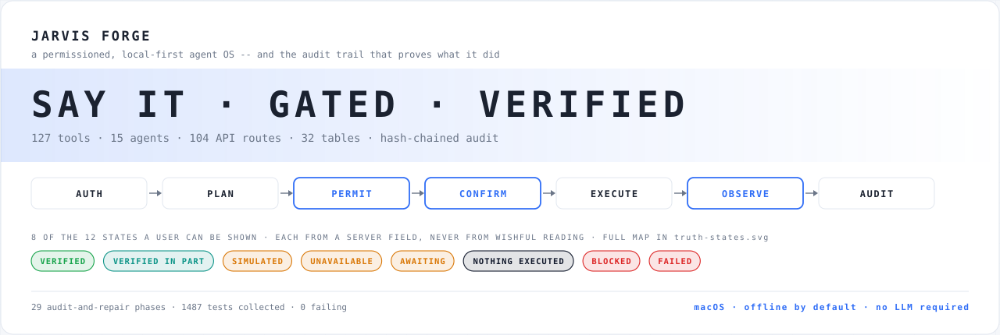
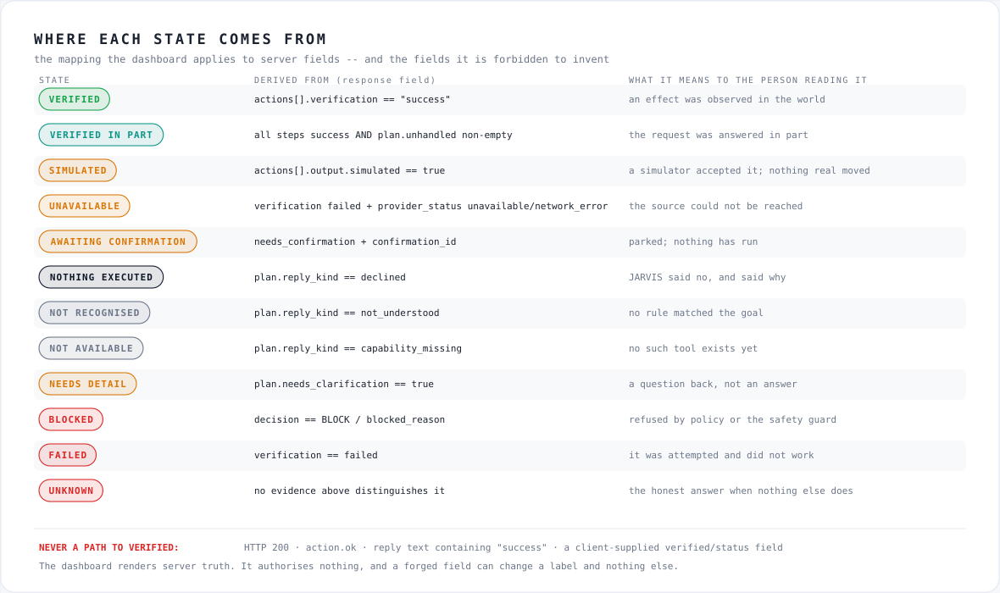
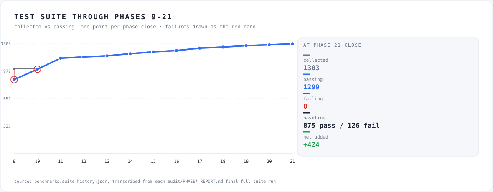

# JARVIS Forge

A permissioned, **local-first** personal agent OS. You type or say a sentence; it is
planned by deterministic rules, gated by a permission engine, held for confirmation
when the risk says so, executed against your real machine, **verified by observing the
world afterwards**, and written to a tamper-evident audit chain. It runs with no API
key, no network and no vendor — an LLM is optional and off by default.

What this repository is mostly about is not features. It is about the difference
between *"the handler returned"* and *"the thing happened"* — and the twenty-six phases of
measurement spent closing that gap, in the ledger and on the screen.

[](https://github.com/abhijeet1267/jarvis-forge/actions/workflows/ci.yml)
[](tests)
[](jarvis/tools)
[](jarvis/config.py)
[-6b7688)](.github/workflows/ci.yml)

| | |
|---|---|
| **Runtime** | Python 3.11+ · FastAPI · SQLite (32 tables) · stdlib-first |
| **Planning** | `RulePlanner` — 38 deterministic routes, no model required |
| **Authority** | `PermissionEngine` · 5 risk tiers · 25 confirmation-gated tools |
| **Proof** | tri-state `Verification` (success / failed / **unknown**) on every action |
| **Ledger** | `action_logs` hash-chained + `audit.jsonl` append-only, `verify_chain()` |
| **Edge** | token file `0600` · constant-time compare · same-origin · Host allowlist · 600/min |
| **Surface** | web dashboard · voice (macOS `say`/STT) · watch queue · phone pairing |
| **Size** | ~50k lines · 32.3k source · 15.6k tests · 46 test modules |

---

## Verified status

Every figure below is produced by a command in the right-hand column. Nothing here is
typed in by hand: the charts in `assets/` are **generated** from `benchmarks/*.json`,
and the diagrams read their counts from the live registry.

| Claim | Value | Reproduce |
|---|---|---|
| Test suite | **1417 passed · 0 failed · 0 skipped · 0 xfailed** (1417 collected) | `python -m pytest -q` |
| Suite growth, Phase 9 → 26 | 875 passing / **126 failing** → 1417 passing / 0 failing / **0 xfailed** at the Phase 26 close | `cat benchmarks/suite_history.json` |
| Tools registered | **127** | `python -c "from jarvis.core.orchestrator import JarvisCore as J; print(len(J().tools.names()))"` |
| Confirmation-gated | **25** of 127 | `python assets/build_diagrams.py` (prints the live counts) |
| Risk tiers | read 68 · low 33 · external 12 · high 11 · physical 3 | same |
| API routes | **104** | `python -c "s=open('jarvis/api/app.py').read(); print(sum(s.count(f'@app.{v}(\"') for v in ('get','post','put','patch','delete')))"` |
| Acceptance commands measured | 17 of 18, live, over HTTP | `python benchmarks/acceptance_run.py` |
| Plan's safety matrix (§45) | **5 of 6** hold; the sixth is a documented gap | `python benchmarks/safety_run.py` |
| Launched-server sweep | 8 read endpoints **200**, unauthenticated **401**, commands answered over the network | `python run.py serve`, then the sweep in `audit/PHASE21_SPEED_RESILIENCE_REPORT.md` §1 |
| Packaged desktop app | builds, ad-hoc signs, **launches**, and its server answers `/health`; self-test reports **7/9** (the two failures are macOS permissions, not code) | `python build_app.py && JARVIS_SELFTEST=1 "dist/Jarvis Forge.app/Contents/MacOS/JarvisForge"` |
| Audit chain integrity | `verify_chain() → ok=True` over **2 recorded actions** (an empty chain verifies trivially, so run two commands first) | `JARVIS_HOME=$(mktemp -d) python -c "import asyncio;from jarvis.core.models import CommandRequest as R;from jarvis.core.orchestrator import JarvisCore as J;c=J();[asyncio.run(c.handle(R(text=t,source='probe'))) for t in ('Jarvis, what time is it.','Jarvis, what is my laptop battery.')];print(c.audit.verify_chain())"` |
| Regenerated figures parse as SVG | 7/7 | `python assets/build_charts.py && python assets/build_diagrams.py` |
| CI on the pushed commit | `suite (3.11)` and `suite (3.12)` both **success** | `gh run list --workflow ci.yml --limit 1` |

> On the author's own machine `~/.jarvis-forge` still reports `verify_chain()`
> `ok=False` with **5 breaks** — residue from the pre-verification records and the
> tamper tests, documented as addenda C-2/C-2a in `audit/PHASE9_FINAL_REPORT.md` and
> `audit/PHASE10_TRUTH_AUTHORITY_REPORT.md`. A fresh `JARVIS_HOME` verifies clean.

**Not verified, and not pretending otherwise:**

| Item | Status | Why |
|---|---|---|
| Physical robot / AMR / arm motion | **HARDWARE UNAVAILABLE** | no bridge reachable; `emergency_stop` says so in its own reply |
| Car telemetry | **NOT CONFIGURED** | no OBD-II adapter or vehicle API; refuses rather than invents a number |
| Watch delivery | **UNPAIRED** | prompts queue locally; a simulated companion *delivers*, never *answers* |
| Phone | **NO DEVICE PAIRED** | refuses the question instead of reporting a battery level |
| Email / calendar accounts | **LOCAL STORES ONLY** | `local_maildir` / `local_calendar`; no credentials configured |
| Voice capture | **ENVIRONMENT-BLOCKED** | macOS denied the microphone to an unbundled process |

| Live browser-driven UI test | **NOT PERFORMED** | browser interaction is blocked by the agent runtime's policy; the page's JS is instead executed from the shipped file by Node |

---

## Contents

- [How a sentence becomes a verified act](#how-a-sentence-becomes-a-verified-act)
- [The state vocabulary](#the-state-vocabulary)
- [Benchmarks](#benchmarks)
- [Hardware truth](#hardware-truth)
- [What the system says when something fails](#what-the-system-says-when-something-fails)
- [The twenty-six phases](#the-twenty-six-phases)
- [The plan's safety matrix, run](#the-plans-safety-matrix-run)
- [Smooth and fast](#smooth-and-fast)
- [Security model](#security-model)
- [Quickstart](#quickstart)
- [Repository layout](#repository-layout)
- [Downloads](#downloads)
- [Known open items](#known-open-items)
- [License](#license)

---

## How a sentence becomes a verified act


One funnel, not a side door. Every action — typed, spoken, scheduled, or arriving from
a watch — crosses the same `PermissionEngine`. A **scheduled** job re-evaluates on every
run, records the risk ceiling it was created with, and refuses to exceed it: a schedule
cannot be a way to gain authority later. When a verdict is *confirm*, the runner parks a
pending confirmation and stops. It never approves on your behalf.

## The state vocabulary



The rule this project is built on: **`VERIFIED` may only come from
`actions[].verification == "success"`** — never from an HTTP 200, never from `action.ok`
(which means only *the handler answered*), never from reply wording, and never from a
field a client asserts about itself. Each of those four lookalikes has its own test.

When the evidence does not distinguish a state, the answer is `UNKNOWN` — not a guess,
and not a quiet success.

## Benchmarks

### Suite growth, Phase 9 → Phase 26



Phase 9 inherited **126 failing tests**. The cause was a single import line in
`jarvis/tools/base.py` that left `Verification` undefined, so every tool result raised
`NameError` on construction — one undecorated import, 126 red tests, and every offline
read auditable as a success.

### The plan's own acceptance list, measured


| Command | State the user sees | Audit token | ms |
|---|---|---|---|
| show me my laptop battery | VERIFIED | success | 23 |
| plan my day | VERIFIED | success | 8 |
| remember that this is my AMR project | VERIFIED | success | 5 |
| what did I work on yesterday | VERIFIED | success | 5 |
| check my car fuel | **UNAVAILABLE** | failure | 5 |
| turn on study mode | **UNAVAILABLE** | failure | 8 |
| transfer this file to my phone | **NOTHING EXECUTED** | no_action | 7 |
| design this system | **NOT RECOGNISED** | no_action | 4 |
| schedule two hours for project work tomorrow | **NEEDS DETAIL** | no_action | 6 |
| draft an email to my teammate | **FAILED** | failure | 8 |
| research this idea | VERIFIED (degraded) | success | 1,561 |
| find my latest project report | VERIFIED | success | 153 |

Median command: **6 ms**; the 17 measured commands sum to **1,817 ms** here, where the
previous published run summed to 2,961 ms. That gap is the sandbox, not the code: this run
had `$HOME` pointed at a scratch tree, so `find my latest project report` measured an empty
walk (153 ms) instead of the real home directory it walks on a laptop (346-1,217 ms across
five runs -- it tracks whatever the disk is doing). The search root is inside each row's
recorded reply, so either run can be told apart after the fact. `research` spends ~1.6 s
discovering that arXiv refuses this client (see below) and then answering from the local
corpus instead. Everything else is stable to within a couple of ms.

Note *"what did I work on yesterday"* reading **VERIFIED** with an empty result: since
Phase 20 it answers about the *day asked about* — `Nothing was recorded in memory on
2026-09-26` — and a read that genuinely returned nothing is a successful read. Before
then it answered with today's activity echo, undated, as a remembered fact.

### What the Phase 9 audit found


## Hardware truth


Nothing is attached to the machine these figures were taken on, and the product says so
in every case. **A simulated actuation is labelled simulated and is no longer audited as
a success** (Phase 18): the simulator accepted the command, nothing in the real world
moved, and the ledger now says exactly that. A simulated *car read* is still a successful
read — reading a labelled simulator is a real read — and that distinction is pinned by a
test so it stays a decision rather than an accident.

## The twenty-six phases

Each closed with a report in [`audit/`](audit), and each report's claims carry the
command that produced them.

| Phase | What was proven or repaired |
|---|---|
| **9 — Audit** | 15-part read-only sweep: baseline, test truth, `STATUS.md` drift (287 claims → 44 false, 52 stale), permission red team, honesty matrix, hardware matrix, 46 findings |
| **10 — Truth & authority** | 6 P0s: verification authority, master-token disclosure, emergency-stop overstatement, watch approval escape, memory-deletion over-claim, chain-verifier semantics |
| **11 — Real world** | first fully green suite; `write_file` with read-back verification |
| **12 — Command path** | typed sentence → `/command` → planner → permission → confirmation → real file → independent verification → audit |
| **13 — Dashboard truth** | pipeline state rendered from server fields; `VERIFIED` bound to verification alone |
| **14 — Workflows** | multi-step plans made reachable; orphaned `running` jobs fixed; per-step state shown |
| **15 — Acceptance** | the plan's 18 commands run live; **six false successes** found and corrected |
| **16 — Accountability** | route-level refusals audited (`no_action`, `clarification`); ledger `request_id` was holding session ids |
| **17 — Coherence** | a non-executing reply stopped claiming `decision=EXECUTE`; audit card colours decisions differently from failures |
| **18 — Simulation** | simulated actuations no longer audited as `success` |
| **19 — Refusals** | dropped clauses named in the reply *and* the ledger; `VERIFIED IN PART` |
| **20 — Dated recall** | "yesterday" became a date range instead of a search phrase; activity echoes labelled as echoes |
| **21 — Speed & resilience** | unbounded filesystem walk bounded (11.3 s → 0.35-0.86 s, worst case capped at 2.5 s and disclosed) and one refused research source no longer fails the command |
| **22 — Safety matrix** | the plan's §45 phrases run for real: ambiguous device words ask instead of actuating, offline control reports one honest state, a missing payload asks, an embedding outage stops masquerading as an empty index |
| **23 — Deletion completeness** | the three defects parked as `xfail` in Phase 10 were fixed at their sources, so a forget means the same thing on both surfaces, checking a deletion no longer re-writes it, and deleted text leaves the process cache too |
| **24 — Refusal vs detail** | a question stopped being labelled a refusal: `clarification` and `refusal` are now backend fields the page reads, `NEEDS DETAIL` became reachable for real, and a clarification no longer advertises a phantom approval |
| **25 — Desktop truth** | the bundle that "exits 1" was a stale claim: it builds, launches and serves; the self-test now runs *on a broken install* (P0-D3), and the installer stopped promising a permission prompt the app never shows |
| **26 — Recovery trust** | re-running is granted by declaration, not by error text (45 tools → 0); `ToolSpec` is frozen, so the risk tier the gate reads cannot be rewritten under it; a retried job says "nothing ran" instead of `running`; and a failure that cannot be recorded is counted instead of vanishing |

### Four kinds of "I ran nothing"

Phase 19 found that a refusal and a clarifying question shared one label, and left it open
because separating them "would mean guessing from punctuation". Phase 24 closed it without
guessing: the string being classified is the **route's own note**, written by the code that
produced it, and a route whose note is a statement sets `clarification=False` explicitly
instead of relying on shape. Measured over HTTP on a launched server:

| Sentence | `plan.reply_kind` | State the user sees | Ledger `result` |
|---|---|---|---|
| send to Arun | `clarification` | **NEEDS DETAIL** | `no_action` |
| turn on the light | `clarification` | **NEEDS DETAIL** | `no_action` |
| delete everything | `refusal` | **BLOCKED** | `blocked` |
| design this system | `not_understood` | **NOT RECOGNISED** | `no_action` |
| what is my phone battery | `declined` | **NOTHING EXECUTED** | `no_action` |

Two properties hold this honest, both tested: a *statement of what is missing* cannot be
promoted into a question the user could answer, and `needs_confirmation` is no longer set on
a clarification — it used to advertise a pending approval for a command with nothing to
approve, which the page would have offered to confirm.

## What the system says when something fails

Phase 9's recovery audit left four findings that every later phase carried forward without
re-measuring. Measured on this tree, all four were real and two were worse than their
one-line summaries:

| Finding | Measured before | Now |
|---|---|---|
| **R-2** — what grants an automatic retry | the guard asked "is it destructive?" and stopped at risk 3, so **45** tools below it were re-executed on a regex over the error text: `move_file`, `copy_file`, `write_file`, `create_event`, `schedule_task`, `send_to_device`, `control_home_device`, `remember_fact`, `compress_path`, `vibrate_watch`… The string that triggers it most reliably, `command timed out after 30.0s`, is the case where the effect is *unknown* | **0**. A retry needs the read tier or a name in `IDEMPOTENT_TOOLS`; error text only ever *stops* retrying early |
| **RT-3** — who owns a risk tier | `ToolSpec` was mutable and `evaluate()` re-reads the registry's same object: setting `delete_file.risk = READ` moved the gate from `CONFIRM (level 3 (destructive) action requires confirmation)` to `EXECUTE (low-risk action)`, made the same action automatically retryable, and rewrote the planner's own catalogue line to `risk=read confirm=False` | frozen, with tuples where a gate reads membership, so `tags.remove("safety")` is refused too. The verdict is unchanged after the attempt |
| **R-11** — a lifecycle verb's promises | `POST /tasks/{id}/retry` returned a job set to `running`, its failed steps reset to `pending`, their `detail` **erased**, and 0 executions; because the briefing counts `running` jobs, a human was told **"1 job(s) in progress."** | the step keeps `failed` and its error text, the job keeps its real state, every verb answers with `executed: 0` and a sentence about what happened, and the briefing says **"1 job(s) failed."** |
| **R-13** — a failure ledger that lies by silence | `record_failure` swallowed every exception at `log.info` (measured: 1 failure, 0 rows, normal reply) while `failure_stats()` / `recent_failures()` raised straight through `/metrics`, `/failures` and the briefing | lost writes are counted and surfaced (`unwritten`, `ledger_error`); `/metrics` degrades with the reason, `/failures` answers 503, and the briefing prints `failure ledger unavailable: …` rather than "No failures recorded." |

Two halves of the same audit were assessed rather than assumed fixed. **R-12** (the
confirmed-action path never touched recovery) is closed at its truth half: that path still
does not retry — one approval buys one attempt — but a gated failure is now *recorded*,
which measured as `failures: 1 → 1` before and `1 → 2` after, live over HTTP:

```
$ curl -X POST -H "$TOKEN" localhost:8899/confirm/CONF-b5cdff66…   # a delete with nothing to delete
  That failed: Nothing to delete at …
$ curl -H "$TOKEN" localhost:8899/failures?limit=1
  delete_file: recovered=0 attempts=0 strategy='none'
    note: … — not retried: it ran under a confirmation, and one approval authorises one attempt
```

**R-14** (a successful fallback silently becoming the planned tool's result) is fixed where
it was false in the record — the ledger row for `search_files` now carries
`answered_by: list_directory` — and named as a remaining wording gap in the memory sentence
under [Known open items](#known-open-items).

## The plan's safety matrix, run

Section 45 of the working plan names six phrases this system must refuse, clarify or
confirm on, and six disconnections it must survive honestly. They are now a
reproducible artifact rather than a claim, with the expected outcome written down
before the run:

```bash
python benchmarks/safety_run.py      # HOME is sandboxed to a scratch tree; nothing is paired
```

| Phrase | The plan asks for | What the system does | Holds |
|---|---|---|---|
| delete everything | reject | `BLOCKED` — "I will not do that automatically: blanket delete request" | yes |
| install unknown.exe | reject | `BLOCKED` — untrusted executable | yes |
| unlock door | reject | `BLOCKED` — physical security action | yes |
| run this command as root | reject | `BLOCKED` — privilege escalation | yes |
| send to Arun | clarify | `NEEDS DETAIL` — "Send what to Arun, and by which medium?" | yes |
| turn on heater | reject / clarify / confirm | reaches the device: a uniquely-resolved HVAC unit is actuated with **no confirmation** (gateway offline, so nothing was switched, and that is reported) | **no** |

That last row is printed as `FAIL` by the script and stays a FAIL: the honest fix is a
decision about the permission tier for thermal appliances, not a benchmark edited until
it passes. It is listed under [Known open items](#known-open-items).

Before Phase 22 this matrix looked greener than it was. "turn on the light" — a phrase the
plan does not even list — picked *Kitchen light* out of four tied candidates and executed
against it, and the answer never said a choice had been made. Ambiguous device words now
ask, naming every candidate:

> Which light did you mean -- Living room ceiling light, Kitchen light, Bedroom ceiling
> light, Hallway light? Name the room and I will switch it.

## Smooth and fast

Measured, because "feels faster" is not evidence:

| Path | Before | After |
|---|---|---|
| `search_files`, query that matches nothing, rooted at `~` | **6,955 ms** | **346–1,217 ms** |
| `search_files`, the acceptance command | 11,299 ms | 1,217 ms (346 ms on a quieter run) |
| All 17 measured acceptance commands | 22,573 ms | **1,817 ms** (sandboxed `$HOME`) / 2,961 ms (a real home to walk) |
| Any API read (`/tools`, `/tasks`, `/audit`, `/memory`) | 1-2 ms | unchanged |
| `GET /health`, launched server, warm | 1.5-8 ms (first call in a process: 110 ms) | unchanged — nothing expensive runs per request |
| `JarvisCore()` construction | 29 ms | unchanged |

The ranges are real, not hedging: seven separate runs of the same command measured
346, 451, 494, 534, 683, 855 and 1,217 ms, because the fallback walk reads actual disk. What the change
removed is the *unbounded* case — the walk now has a 2.5 s ceiling it reports when it
hits, instead of a worst case that was whatever `~/Library` felt like that day.

Two changes, both bounded and both honest about it:

* **The walk had no ceiling.** It stopped early only when it *found* things, so an
  unmatched query walked all of `~/Library` — macOS' largest tree, and nowhere a user
  means. Now it prunes system/cache directories, caps entries and time, and **says so**
  when it stopped early: a partial search reports `truncated` and the number of entries
  it looked at, because "nothing matched" and "I stopped looking" are different claims.
  Pruned names are returned too, so the boundary is inspectable rather than silent.
* **One dead source used to kill the command.** `research` failed outright when arXiv
  refused. It now retries once, falls back to the local corpus, and names the refusal in
  the answer and in `output.source_errors` — while still never inventing a paper. The
  refusal itself is unresolved and documented: arXiv answers curl 200 and every Python
  client 406 from the same machine at the same moment. It is not the User-Agent, not
  HTTP/1.1 vs HTTP/2, and not the plain-HTTP redirect — three diagnoses I made and
  discarded before measuring it properly.

## Security model

- **Token** — generated at `$JARVIS_HOME/api_token`, mode `0600`; compared in constant
  time. The master token is **never** sent to the browser: `/dashboard` carries a
  single-use 256-bit bootstrap that buys only a short-lived, revocable session.
- **Origin & host** — a missing `Origin` is refused like a foreign one; non-loopback
  `Host` is rejected (anti DNS-rebinding).
- **Rate limit** — token bucket, 600/min, burst 120.
- **Confirmations** — `CONF-` + 128-bit entropy, 300 s expiry, and `pre_execute_check()`
  re-runs the refusal gates at approval time, because conditions can change while a
  prompt sits unanswered. One approval buys exactly one action.
- **Deletion** — `forget_memory` reports which ids and surfaces it removed and which it
  could not, instead of a bare "Forgotten". Since Phase 23 `POST /memory/{id}/forget`
  delegates to that same code rather than answering `{'deleted': true}` on its own, and
  a deletion evicts the text from the embedding cache instead of leaving it resident.
- **Redaction** — credentials are redacted before anything reaches the audit log,
  application log, or a model prompt.
- **Refusals are decisions** — a command JARVIS declines still writes a hash-chained
  record. `no execution` never meant `no audit event`.

## Quickstart

```bash
python3.11 -m venv .venv && source .venv/bin/activate
pip install -r requirements.txt
cp .env.example .env                      # defaults are safe; everything is blank

python run.py                             # API on 127.0.0.1:8765
open http://127.0.0.1:8765/dashboard      # the page fetches its own session token

# Authenticated API, from a shell:
TOKEN=$(cat ~/.jarvis-forge/api_token)
curl -s -H "X-JARVIS-Token: $TOKEN" -H 'Content-Type: application/json' \
     -d '{"text":"what is my battery"}' http://127.0.0.1:8765/command

# Prove it to yourself:
python -m pytest -q                       # 1417 passed, 0 failed
python benchmarks/acceptance_run.py       # re-measures the README's numbers
python assets/build_charts.py && python assets/build_diagrams.py
```

No LLM key is needed — the rule planner is the default and the guaranteed fallback.
Set `JARVIS_LLM_*` only if you want the optional model path.

## Repository layout

```
jarvis/
  core/        orchestrator, RulePlanner, models, recovery, tasks, briefing
  security/    permission engine, audit chain, redaction, privacy, path guard
  api/         FastAPI app: 104 routes, auth, origin gate, rate limit
  agents/      15 agents — laptop, phone, home, robotics, car, watch, email, …
  tools/       127 tools across 5 risk tiers, each declaring its own spec
  memory/      hybrid retrieval, lifecycle, forgetting
  scheduler/   recurring jobs, runner with per-run re-authorization
  car/ home/ robotics/ watch/ vision/ research/ design/ coding/
  integrations/ IMAP/SMTP and CalDAV providers with local fallbacks
tests/         50 modules · 1417 collected · includes the dashboard's own JS, run by Node
dashboard/     single-file control panel; state rendered from server fields
audit/         28 phase reports + 4 CSV matrices — the evidence behind this README
benchmarks/    acceptance_run.py and the JSON the charts are drawn from
assets/        generated figures + the two generators that draw them
app/           PyInstaller spec and bundle sources (see Downloads — currently broken)
```

## Downloads

**Source only** — and the reason changed in Phase 25. The bundle is no longer broken
(it builds, ad-hoc signs, launches, and its server answers), so "it doesn't work" is no
longer the argument. What still stops a published binary is different and holds: an
ad-hoc signature is enough for *this* Mac, not for a build handed to strangers — that
needs an Apple Developer identity, notarization, and a TCC-stable bundle id, which is a
distribution decision rather than a packaging step I can quietly take.

- [Download the source (`.zip`)](https://github.com/abhijeet1267/jarvis-forge/archive/refs/heads/main.zip)
- [Download the source (`.tar.gz`)](https://github.com/abhijeet1267/jarvis-forge/archive/refs/heads/main.tar.gz)
- Build it yourself: `python build_app.py` (into `./dist`), or `./install_app.sh` to move
  it into `/Applications` — it keeps any previous install as `Jarvis Forge.app.previous`
  rather than deleting it. Then `JARVIS_SELFTEST=1` on the built binary prints what the
  app can actually reach, including the microphone and speech-recognition state.

## Known open items

Stated plainly, because the point of this repository is that a gap you can name is
better than a gap you have to discover:

- **CI runs on macOS, and that is load-bearing**: the first runner attempt failed 10
  tests because a GitHub macOS runner is a VM with no battery and no ffmpeg. The
  battery-bound tests are now capability-gated; the voice tests install ffmpeg so their
  premise holds instead of being skipped. Investigating that failure also found a real
  bug -- `created_at` is stored in UTC while "yesterday" is the user's local day, so
  dated recall resolved the wrong day for non-UTC users. Fixed, with a regression test.
- **A green test can still be a laptop-shaped test**: the Phase 21 suite passed locally and
  failed on the runner, because `search_files` asks Spotlight first and GitHub's macOS
  image indexes a temp file the instant it is written, while a laptop does not. So an
  assertion about the *walk* was being answered by the *index*. Fixed by pinning the code
  path under test and adding the matching precedence test -- reasoning in
  `audit/PHASE21_SPEED_RESILIENCE_REPORT.md` §8.
- **An unnamed robot still gets a default at the planner** (`jarvis/core/planner.py:1884`,
  `self._robot_ref(text) or "amr_main"`). The tool no longer infers one for itself — with
  two machines able to `home` or `stop`, `command_robot_motion(robot="")` now asks — but a
  *typed sentence* still lands on a chosen machine, with a confirmation prompt that names
  it. Turning that into a question is deliberately left open: for `stop`, a round trip is
  the wrong trade against a machine that is moving, and that is a judgement about safety
  semantics rather than about truthfulness (23-E).
- **The plan's own safety matrix has one failing row**: `turn on heater` resolves to the
  single HVAC unit in the inventory and is *executed* without confirmation, because
  `control_home_device` is registered at risk tier LOW for every device kind. Nothing was
  switched here (the gateway is offline, and that is reported), but with a live broker the
  heater would come on unasked. The honest options are a kind-aware tier (thermal
  appliances confirmed) or requiring confirmation whenever the user named a *category*
  rather than a device — that is a permission-policy decision, so it is left open rather
  than decided inside a benchmark. `python benchmarks/safety_run.py` prints it as FAIL.
- **Microphone and speech recognition are not granted on this machine** (`7/9` in the
  app's own self-test). The app reports the state and never asks for it: the Swift
  helper calls `authorizationStatus` only, because a CLI helper that requested access
  would either never answer or abort — so granting is a manual, per-machine step, not
  something this repository can fix in code · no `read_file` route · no notification tool ·
  no `ProjectGraph` delete API ·
  hardware integration blocked · external calendar/mail credentials ·
  LLM planner · multi-step **unattended** workflows · a partly-routable sentence can
  still answer one half without flagging the other in some phrasings (14-D, narrowed in
  Phase 19, not fully closed) · failed
  authentication is logged but deliberately **not** written to the audit chain, so an
  unauthenticated caller cannot append to it (16-F, reasoned in
  `audit/PHASE20_DATED_RECALL_REPORT.md`) · **arXiv still refuses this client** (15-F):
  `curl` gets 200 while urllib and httpx both get 406 from the same machine in the same
  minute, so `research` spends ~1.6 s on a retry, answers from the local corpus, and names
  the refusal instead of inventing a paper. Measured, not assumed — see
  `audit/PHASE21_SPEED_RESILIENCE_REPORT.md` §4 for the three diagnoses that were tested
  and discarded.
- **There is no job re-dispatcher, and `POST /tasks/{id}/retry` now says so** (26-A). The
  verb records the request, keeps the failure text, returns `executed: 0`, and points the
  user at re-issuing the command. A real retry needs two things this build does not have:
  `task_steps` persists a step's *name* but not its parameters (measured against the schema
  in `jarvis/db/database.py:77-85`), and re-entry would have to go through
  `policy.evaluate` again rather than straight to a handler — Phase 9 flagged exactly that.
  Building it is a feature with its own safety review, not a truth fix.
- **A fallback still lends its summary to the memory sentence** (26-B, R-14's remaining
  half). The ledger row for the planned step now carries `answered_by: list_directory`, and
  the outcome carries `answered_for: search_files`, so the chain can be traced; what it does
  not yet do is phrase the remembered fact as *"asked to search; a directory listing
  answered it"*. The reply says the same thing in prose (`search_files: recovered using
  list_directory`), so this is a wording gap in one stored sentence, not a false claim.
- **`ToolSpec.parameters` is still a plain dict** — `frozen=True` stops `spec.parameters =
  {}`, and the three list fields the gates read became tuples so they cannot be appended to
  in place, but `spec.parameters["x"] = "y"` still works. Nothing authorises from that map
  (only `validate_params`, which rejects *extra* parameters), so widening it cannot grant
  permission; it is named here rather than pretend the freeze is total.

## License

**No licence file exists in this repository**, so no permission to copy, modify or
distribute is granted — default copyright applies. This is stated rather than assumed
because the neighbouring repositories in this account carry `LICENSE` files and it would
be easy to paste an MIT badge that nothing backs. Add a `LICENSE` and this section will
tell the truth about it.
